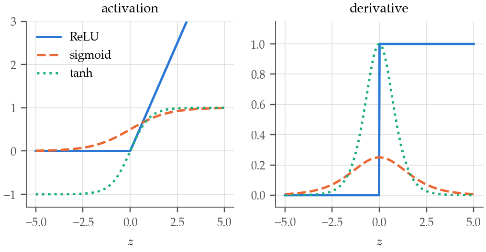

# 5 — Non-linearities (ReLU and Softmax)

A network of `Dense` layers alone can only learn linear functions, no
matter how deep it is. This chapter explains why, then builds the two
activations we need for our first classifier: `ReLU` for hidden layers
and `Softmax` for the output of a multi-class classifier.

---

## 1. Why nonlinearities are necessary

Stack two `Dense` layers with nothing between them:

```
H = W₁·X + b₁
Z = W₂·H + b₂
```

Substitute and rearrange:

```
Z = W₂·(W₁·X + b₁) + b₂
  = (W₂·W₁)·X + (W₂·b₁ + b₂)
  = W'·X + b'
```

The two-layer network is mathematically identical to one Dense layer
with `W' = W₂·W₁` and `b' = W₂·b₁ + b₂`. The same algebra extends to any
depth: composing affine functions yields an affine function. An affine
model can only learn linear decision boundaries (straight lines or
hyperplanes), so it can't represent XOR, curves, or hierarchical
features.

Any non-linear function between layers prevents this collapse. The
simplest one that works very well in practice is **ReLU**.

---

## 2. ReLU

```
ReLU(z) = max(0, z)      element-wise
```

Negative entries become zero; non-negative entries pass through. The
shape is preserved, because the operation is element-wise.

### Backward {#sec-05-activations-backward}

ReLU's derivative is:

```
dReLU/dz = 1   if z > 0
         = 0   if z < 0
         (undefined at z = 0; we pick 0 by convention — exactly-zero values
          have measure zero in practice and the choice does not matter)
```

Because the operation is element-wise, every output depends only on the
corresponding input, so the Jacobian is diagonal and backward reduces
to a Hadamard product:

```
dZ = dA ⊙ mask,    where mask[i,j] = 1 if Z[i,j] > 0 else 0
```

In words: pass the upstream gradient through wherever the input was
positive, and set it to zero everywhere else. ReLU is sometimes called
a "gating" function for this reason: it gates the gradient flow based
on the forward sign pattern.

### Why it works so well

ReLU has dominated since ~2012 for practical reasons:

- Element-wise and very cheap to compute and differentiate.
- No saturation in the positive direction (compare with `sigmoid` and
  `tanh`, which flatten out for large inputs, so their gradient
  vanishes).
- Encourages sparse activations: at any given time, many units output
  exactly zero, which acts as an implicit form of regularisation.

ReLU has a failure mode: a unit can get stuck in the dead region
(always outputting 0, always receiving 0 gradient), which is called
"dying ReLU". Variants like Leaky ReLU and ELU address this. We'll add
Leaky ReLU later if we need it; plain ReLU is fine for IRIS.

---

## 3. Softmax, from scores to probabilities

For multi-class classification, the final layer needs to output a
probability distribution over `K` classes. Softmax does that. For each
example (each column):

```
softmax(z)ᵢ = exp(zᵢ) / Σₖ exp(zₖ)
```

It follows directly that:

- Each output is in `(0, 1)`.
- Outputs sum to 1.
- The largest logit becomes the largest probability (monotonicity).

So we get a valid probability distribution in which the class the
network scores highest has the highest probability. Softmax is
per-column: unlike ReLU, every output depends on every input within an
example.

### 3a. Numerical stability (log-sum-exp shift)

`exp(z)` for `z = 1000` overflows. The fix uses an algebraic identity:

```
softmax(z) = softmax(z − c)    for any constant c
```

Proof: multiply numerator and denominator of `softmax(z − c)` by `exp(c)`;
the factors cancel and you are back at `softmax(z)`.

So we can shift all logits by any constant without changing the answer.
The standard choice is to shift by the column max:

```
m = max(z)
softmax(z)ᵢ = exp(zᵢ − m) / Σₖ exp(zₖ − m)
```

After shifting, the largest exponent is `exp(0) = 1`, which does not
overflow. The rest are `exp(negative) ∈ (0, 1]`, which do not overflow
either. Tiny terms may underflow to 0, but that is the correct answer.
This shift is mandatory for any real-world Softmax; every framework
does it.

### 3b. The Jacobian

This is the first layer where every output depends on every input, so
the Jacobian is not diagonal. We derive it in full.

Fix one column (one example). Let `s = softmax(z)`, so `sᵢ = e^{zᵢ} / D`
with `D = Σₖ e^{zₖ}`. By the quotient rule:

- **`i = j` (diagonal entry)**:

```
∂sᵢ/∂zᵢ = (e^{zᵢ}·D − e^{zᵢ}·e^{zᵢ}) / D²
        = (e^{zᵢ}/D) · (1 − e^{zᵢ}/D)
        = sᵢ · (1 − sᵢ)
```

- **`i ≠ j` (off-diagonal)**:

```
∂sᵢ/∂zⱼ = (0·D − e^{zᵢ}·e^{zⱼ}) / D²
        = −(e^{zᵢ}/D) · (e^{zⱼ}/D)
        = −sᵢ · sⱼ
```

Packed together with the Kronecker delta:

```
∂sᵢ/∂zⱼ = sᵢ · (δᵢⱼ − sⱼ)
```

### 3c. Backward from the Jacobian

Chain rule for `∂L/∂zⱼ`:

```
∂L/∂zⱼ = Σᵢ (∂L/∂sᵢ) · ∂sᵢ/∂zⱼ
       = Σᵢ (∂L/∂sᵢ) · sᵢ · (δᵢⱼ − sⱼ)
       = sⱼ · (∂L/∂sⱼ) − sⱼ · Σᵢ sᵢ · (∂L/∂sᵢ)
       = sⱼ · [(∂L/∂sⱼ) − dot]            where dot = Σᵢ sᵢ · (∂L/∂sᵢ)
```

So per column the backward pass is:

1. Compute the scalar `dot = sᵀ · dS` for that column.
2. For each entry: `dZ[i,j] = S[i,j] · (dS[i,j] − dot)`.

The column loop in `src/Softmax.h` contains these two passes.

### 3d. The Softmax + cross-entropy shortcut (preview)

In classification networks, Softmax is almost always paired with
**cross-entropy loss** `L = -Σᵢ tᵢ · log(sᵢ)` where `t` is the one-hot
target. If you compute the combined gradient,
`∂L/∂z = ∂L/∂s · ∂s/∂z`, almost everything cancels, and what remains
is:

```
∂L/∂z = S − target
```

That is much simpler and numerically better-behaved than chaining the
standalone Softmax backward with a standalone cross-entropy backward.
[Chapter 7](07_cross_entropy.md) derives it. In weft the two stay
separate classes. A test compares their composition with `(S − T)/N`
at moderate logits. The current cross-entropy adds epsilon, so this
agreement is approximate and can fail badly for extreme wrong
predictions; chapter 7 explains the distinction.

The standalone Softmax backward we implemented is still correct on its
own (verified by the numerical gradient check in `test_softmax.cpp`),
and we keep it because Softmax may also be used outside the standard
classification setup (e.g. attention layers, custom losses).

---

## 4. Other activations (briefly)

- **Sigmoid** `σ(z) = 1 / (1 + exp(−z))`: maps to `(0, 1)`, derivative
  `σ(1 − σ)`. Used historically and still occasionally for binary
  classification outputs. Suffers from saturation (vanishing gradient for
  large `|z|`), so usually avoided in hidden layers.
- **Tanh** `tanh(z)`: maps to `(−1, 1)`, derivative `1 − tanh²(z)`.
  Zero-centred unlike sigmoid, but still saturates.
- **Leaky ReLU** `max(αz, z)` with small `α` (e.g. 0.01): keeps a small
  non-zero gradient for negative inputs to avoid the "dying ReLU" problem.
- **GELU**, **Swish**: smoother variants of ReLU used in modern
  transformers.

We add these when we need them. For IRIS, ReLU is enough.



---

## 5. The following chapters {#sec-05-activations-the-following-chapters}

We have everything for the forward pass of a classifier: `Dense →
ReLU → Dense → Softmax`. To train it, we need a loss function.
[Chapter 6](06_jacobian.md) first describes what we have done in terms
of the Jacobian. [Chapter 7](07_cross_entropy.md) covers
**cross-entropy** and the combined Softmax+CE gradient, and
[chapter 8](08_network.md) connects the pieces for the first
end-to-end network on IRIS.


## Further reading {#sec-05-activations-further-reading}

The rectified linear unit became the default hidden activation after
[@nair2010relu]. The softmax output, and its reading as a probability
distribution over classes, is due to [@bridle1990softmax].
