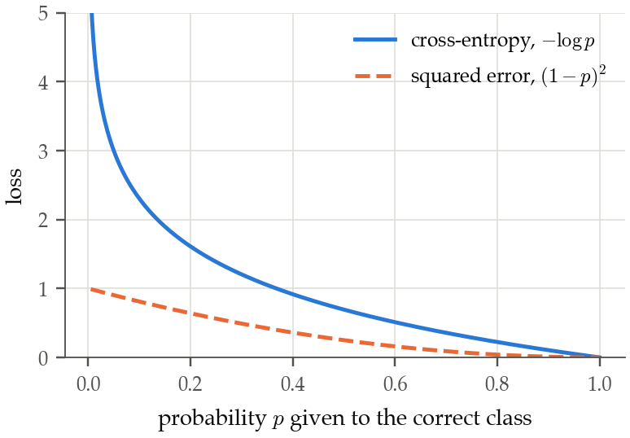

# 7 — Cross-entropy loss (and the Softmax+CE shortcut)

Cross-entropy measures the probability a classifier assigns to its
targets. Pairing it with softmax gives a particularly simple gradient
with respect to the logits: `(S − T) / N`. We derive that identity,
then distinguish it from the legacy probability-space calculation.
The training examples use a fused logits-based loss so that confidently
wrong predictions still receive a corrective gradient.

---

## 1. Why not squared error?

Squared error penalises numeric distance: `(prediction − target)²`.
It is useful for reconstructing real-valued quantities, and it can also
score probability predictions. Here we use cross-entropy because it
corresponds to the categorical model's negative log-likelihood.

There is also a gradient argument. Backpropagating squared error through
a saturated softmax can give a small logits gradient even when the
predicted class is wrong. For the unmodified cross-entropy objective,
the softmax factor cancels, leaving a strong correction for that error.

---

## 2. Cross-entropy: definition and interpretation

Given a target distribution `t` and a predicted distribution `s` over `K`
classes:

$$
H(t,s) = -\sum_{i=1}^{K} t_i \log s_i.
$$

The quantity `−log(sᵢ)` is the **surprise** of seeing class `i` when the
model assigned it probability `sᵢ`. If the model predicts 0.99 for the
class that occurs, the surprise is small (`≈ 0.01`). If it predicts
0.001, the surprise is large (`≈ 6.9`). Cross-entropy is the expected
surprise, weighted by the true distribution.

For a one-hot target (the usual classifier setup, where the true class
`c` has `t_c = 1` and the others are 0), the sum reduces to one term:

$$
H(t,s) = -\log s_c.
$$

The loss is the negative log of the probability the network assigned to
the correct class. With 99% on the correct class the loss is ~0.01. With
1% it is ~4.6. At zero probability the ideal loss is infinite. Softmax
has strictly positive outputs in exact arithmetic, but finite-precision
exponentials can underflow to zero.

> **Equivalent perspective: maximum likelihood.** If your model outputs
> `P(class | input) = sᵢ`, then the likelihood of the data is the product
> of `s_{cₙ}` over examples. Maximising likelihood is equivalent (taking
> logs) to minimising `−Σₙ log(s_{cₙ})`, which is cross-entropy with
> one-hot targets. The information-theoretic and the probabilistic
> arguments give the same loss.



---

## 3. The batch form

Average over `N` examples:

$$
L = -\frac{1}{N}\sum_{n=1}^{N}\sum_{i=1}^{K}
T_{i,n}\log S_{i,n}.
$$

Averaging keeps a fixed per-example scale as batch size changes. Batch
size can still affect optimization through gradient noise and the
number of updates per epoch.

By the convention of [chapter 3](03_backprop.md), the `1/N` factor is
part of the gradient returned by the loss class, not of the backward
formulas of the layers below it. This keeps layer code simple: layers
never handle batch-size arithmetic.

---

## 4. The standalone gradient

Differentiating with respect to `Sₙ[i]` (one entry of the predicted
distribution for one example):

$$
\frac{\partial L}{\partial S_{i,n}}
= -\frac{T_{i,n}}{N S_{i,n}}.
$$

This is the derivative of the ideal objective. Its magnitude grows
without bound as the probability of a target class approaches zero.
Evaluating it separately from softmax is numerically fragile. The
current `CrossEntropy::backward()` adds epsilon to the denominator;
section 6 explains how that changes the objective and the gradient.

---

## 5. The Softmax + CE shortcut

The Softmax Jacobian (from [chapter 6](06_jacobian.md)) is
`∂Sᵢ/∂Zⱼ = Sᵢ(δᵢⱼ − Sⱼ)`. Chain it with the CE gradient for
one example, temporarily omitting the batch factor:

$$
\begin{aligned}
\frac{\partial L}{\partial Z_j}
&= \sum_i \frac{\partial L}{\partial S_i}
           \frac{\partial S_i}{\partial Z_j} \\
&= \sum_i \left(-\frac{T_i}{S_i}\right)
           S_i(\delta_{ij}-S_j) \\
&= -T_j + S_j\sum_i T_i \\
&= S_j-T_j.
\end{aligned}
$$

The last line uses the fact that the target probabilities sum to one.

Adding the `1/N` batch factor gives:

$$
\frac{\partial L}{\partial Z} = \frac{S-T}{N}.
$$

The combined gradient through Softmax and cross-entropy is the
prediction minus the target, divided by the batch size. The reciprocal
probability in the cross-entropy derivative cancels the probability
factor in the softmax Jacobian.

The combined form has these advantages:

- **Pedagogical**: the gradient has a direct meaning. Where the
  predicted probability exceeds the target, the update pushes it down;
  where it falls short, the update pushes it up. The magnitude is the
  discrepancy.
- **Numerical**: no `Sᵢ` ever appears in a denominator in the combined
  form. Softmax probabilities that underflow cause no problem.

This identity motivates evaluating the loss directly from logits. It
avoids forming a tiny probability only to take its logarithm and divide
by it. `SoftmaxCrossEntropy` uses that path in the training examples.
The separate classes remain useful for inspecting the derivation.

---

## 6. Probability-space loss and stable training

Separate `Softmax` and `CrossEntropy` classes make the chain rule easy
to inspect. The legacy `CrossEntropy` guards against `log(0)` by adding
$\epsilon=10^{-12}$:

$$
\begin{aligned}
L_\epsilon
&= -\frac{1}{N}\sum_{n,i}T_{i,n}\log(S_{i,n}+\epsilon),\\
\frac{\partial L_\epsilon}{\partial S_{i,n}}
&= -\frac{T_{i,n}}{N(S_{i,n}+\epsilon)}.
\end{aligned}
$$

Those two calculations agree with each other, but they are a modified
objective. The epsilon prevents exact cancellation with the softmax
Jacobian. For a one-hot target of class $c$, the logits gradient is:

$$
\frac{\partial L_\epsilon}{\partial Z_{:,n}}
= \frac{S_{c,n}}{S_{c,n}+\epsilon}
  \frac{S_{:,n}-T_{:,n}}{N}.
$$

When the target probability is comfortably above epsilon, the extra
factor is close to one. The existing combined-gradient test checks that
regime within its numerical tolerance. It does not establish equality
for arbitrary logits.

For a single example with double-precision logits `(50, -50)` and the
second class as target, the ideal loss is approximately 100 and the
logits gradient is approximately `(1, -1)`. The legacy probability-space implementation
instead gives a loss near 27.631 and a gradient near
`(3.72e-32, -3.72e-32)`. A confidently wrong prediction receives
almost no correction. This is a limitation of that probability-space path,
including for a small classifier if it reaches extreme logits.
The training examples now avoid this path.

A stable logits-based loss uses log-sum-exp. For one example with
target class $c$ and $m=\max_i Z_i$:

$$
L = m + \log\!\left(\sum_i e^{Z_i-m}\right) - Z_c.
$$

`SoftmaxCrossEntropy::backward()` returns the logits gradient directly.
The classifier's last layer therefore emits logits, with no Softmax
layer in the network itself. After `forward(logits, targets)`, the
loss's `probabilities()` accessor supplies normalized predictions for
uses such as averaging frame predictions by file. Generation can still
call standalone Softmax when probabilities are needed.

---

## 7. What we built {#sec-07-cross-entropy-what-we-built}

`src/Loss.h` is the abstract base, with `forward(predicted, target) ->
scalar` (caches its inputs) and `backward() -> dL/d(predicted)`. By
convention, the mean-over-batch `1/N` factor is part of the gradient.

`src/CrossEntropy.h` is the concrete loss:

- `forward`: computes the average cross-entropy. A small `eps` is added
  inside `log` to guard against an exact zero in `predicted`.
- `backward`: computes `−T / (N * (S + eps))` elementwise.

`tests/test_crossentropy.cpp` contains these tests:

1. Forward on a hand-checkable single example: `L = −log(0.7)`.
2. Forward batch averaging.
3. Numerical gradient check on `dL/dS`.
4. **The combined identity at moderate logits**: compares
   `Softmax.backward(CE.backward())` with `(S − T)/N` to a tolerance.
   The epsilon makes this an approximation, as section 6 shows.
5. Full-chain numerical gradient check: perturb each logit `Z[i,j]`,
   confirm `(L(Z+ε) − L(Z−ε))/(2ε)` matches the `dZ` produced by chaining
   `Softmax.backward(CE.backward())`.

All 35 checks in the five test programs so far (Matrix, Dense, ReLU, Softmax, CrossEntropy)
pass.

`tests/test_softmax_crossentropy.cpp` additionally checks extreme logits,
underflow, soft targets, batch averaging, shift invariance, numerical
gradients, and a training step from a confidently wrong initialization.

---

## 8. The classifier so far

We now have every component of a classifier:

```
Dense  →  ReLU  →  Dense (logits)  →  SoftmaxCrossEntropy
```

The next chapter combines these in a small `Network` class that holds an
ordered list of layers and runs them forward and backward as a unit.
Then [chapter 9](09_iris.md) trains it on the IRIS dataset, the first
training run on real data.

## 9. Exercise: when does epsilon matter?

For the legacy probability-space path, evaluate the extra gradient factor
$S_c/(S_c+\epsilon)$ at target probabilities `1e-2`, `1e-12`, and
`1e-20`, with `epsilon = 1e-12`. At which point does the current
implementation stop approximating the ideal logits gradient? Explain
why a numerical derivative check of the epsilon-modified forward loss
can still pass.


## Further reading {#sec-07-cross-entropy-further-reading}

Entropy and cross-entropy as measures of information come from
[@shannon1948communication]. The pairing of a softmax output with a
cross-entropy loss, and the probabilistic argument for it, is in
[@bridle1990softmax].
