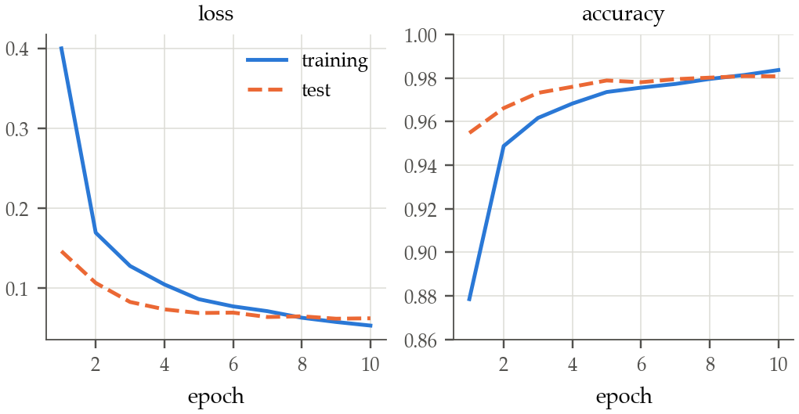

# 12 — MNIST classifier

MNIST is the standard test of whether a neural network implementation
works: 60,000 training and 10,000 test images of 28×28-pixel handwritten
digits, labelled 0-9. It is small enough to train on a laptop CPU in
seconds, and big enough that the regularisation and optimisation choices
of the last few chapters make a difference.

This is the first weft example that uses every part of the library at
once: the IDX loader, an MLP with hidden Dense layers, ReLU,
Dropout, Softmax, cross-entropy, Adam, and train/eval mode switching.

---

## 1. The data pipeline

```cpp
X_train = mnist::load_images<float>(data_dir + "/train-images-idx3-ubyte");
y_train = mnist::load_labels       (data_dir + "/train-labels-idx1-ubyte");
Y_train = one_hot<float>(y_train, 10);
```

`load_images` returns a `(784, 60000)` matrix, with one column per image
and pixel values normalised to `[0, 1]`. This is already a reasonable
scale for He-initialised Dense layers, so we skip the Standardizer. (The
standard PyTorch tutorial normalises to mean 0.1307, std 0.3081, but
the difference in final accuracy is very small, so we keep the simpler
pipeline.)

`load_labels` returns a `vector<int>` of digit indices. `one_hot<float>`
turns that into a `(10, 60000)` matrix with a single 1 per column.


---

## 2. The architecture

```
Dense(784, 256) -> ReLU -> Dropout(0.3)
Dense(256, 128) -> ReLU -> Dropout(0.3)
Dense(128, 10)  -> Softmax
```

The network has about 235,000 parameters. That is large enough relative
to 60,000 training examples that overfitting is a risk, which is the
regime where dropout is useful.

**Two hidden layers, not one or five.** A single hidden layer can in
principle approximate any continuous function (universal approximation
theorem), but in practice deep narrow networks compose features more
efficiently than wide shallow ones. Two hidden layers are enough to
reach ~97-98% on MNIST, and the network is not deep enough for
vanishing-gradient issues or training instability to matter.

**256 -> 128, not 256 -> 256 or 128 -> 64.** Powers of two are a
historical convention (originally cache- and SIMD-friendly), and widths
that decrease from layer to layer are a sensible default: early layers
extract many low-level features, and later layers compress them into
class-relevant ones. The exact widths are not critical; ±2x in any of
them changes final accuracy by a fraction of a percent.

**Dropout 0.3 instead of the classic 0.5.** 0.5 is what Srivastava's
2014 paper used on much larger fully-connected networks. With our
modest width, 0.3 regularises enough without slowing convergence too
much. 0.2 or 0.4 would work nearly as well.

**No dropout on the input or the classification head.** Dropout right
before the softmax would zero class logits, which makes no sense.
Dropout on raw pixels is possible but weak; augmentation in the style
of random crops suits the input better.

---

## 3. The optimiser choice

We use Adam, not SGD. SGD with a careful learning rate schedule would
probably reach similar accuracy, but Adam is much easier to tune. With
a single hyperparameter (lr = 1e-3) and no schedule, it converges to
~98% test accuracy in ten epochs.

Plain SGD at the same learning rate would either diverge or converge
very slowly, depending on the value. SGD with momentum at lr ≈ 0.01
with a learning rate decay would be competitive, but you'd have two
hyperparameters to set well instead of one. For this kind of problem,
Adam's advantage is that it needs less tuning.

---

## 4. The training loop in detail

```cpp
for (int epoch = 1; epoch <= epochs; ++epoch) {
    net.train();                                  // (a)
    auto idx = shuffled_indices(X.cols(), epoch);

    for (mini-batches) {
        Matrix S = net.forward(X_batch);
        float  L = ce.forward(S, Y_batch);
        net.backward(ce.backward());
        net.update(opt);
    }

    net.eval();                                   // (b)
    auto [test_loss, test_acc] = evaluate(...);
}
```

The two mode switches are new compared to the IRIS example.

`(a)` puts the network into training mode. Dropout is active and
randomly zeroes 30% of each hidden activation. We corrupt the
activations deliberately, to force the network to be redundant; the
test pass then uses the uncorrupted activations.

`(b)` puts the network into inference mode. Dropout becomes the
identity. The network we evaluate is the full, un-corrupted one.

Without `(b)`, the test accuracy reported each epoch would be measured
on a randomly-corrupted network. It would be much lower, and not
representative of the model the user wants to deploy.

**Mini-batch size.** A batch of 128 is a good compromise for MNIST.
Larger batches (512+) have less stochastic noise per update, which can
help final accuracy slightly but means fewer updates per epoch. The
current view is that the noise helps generalisation, so the trade-off
is roughly even. Smaller batches (16) spend time on per-iteration
overhead and don't vectorise well.

---

## 5. Train vs test accuracy: reading the gap

The "train acc" reported in our table is the running accuracy during
the training pass, measured with dropout still active. The "test acc"
is measured in eval mode.

Test accuracy often exceeds train accuracy, especially early in
training. This is not a bug; it is the intended effect of dropout.
During training the network has to make correct predictions with 30% of
its activations zeroed. The test pass uses the full network and does
noticeably better.

Later in training, as the network starts to overfit, train accuracy
(even with dropout) catches up with test accuracy and eventually
exceeds it. When it crosses over and the gap starts to grow, consider
stopping training or strengthening regularisation. The gap between the
two is a basic diagnostic.



---

## 6. Running it

You need the four uncompressed MNIST IDX files. The download script
in `data/` fetches them from a reliable mirror:

```
chmod +x data/download_mnist.sh
./data/download_mnist.sh
```

Then from `build/`:

```
make
./examples/mnist_classifier              # uses ../data/mnist
./examples/mnist_classifier /some/path   # or pass a path
```

The expected output is ~98% test accuracy after ten epochs, in about
ten seconds on a modern laptop. (It took minutes before the threaded
matrix product of [chapter 20](20_performance.md).)

---

## 7. What's missing

A more complete MNIST classifier would do the following, which we
deliberately omit:

- **Learning rate schedule.** Adam adapts per-parameter, but a global
  step-decay or cosine schedule on top can add another half-percent
  of accuracy. It is not worth the complexity here.
- **Data augmentation.** Random shifts of ±2 pixels and small rotations
  are the classic MNIST technique, and they reliably take an MLP from
  ~98% to ~99%. This requires an image-aware augmentation layer, which
  we do not have.
- **Validation set.** We use the test set for per-epoch evaluation,
  which is methodologically lax. In a published result you would hold
  out part of the training set for validation and use the test set
  only once, at the end. For a learning project the shortcut is
  acceptable.
- **Model checkpointing.** Save the best-test-accuracy model rather
  than the last-epoch one. It is easy to add when needed.
- **ConvNets.** The large improvement from ~98% for an MLP to ~99.5%+
  comes from using the 2D structure of the image with convolutional
  layers instead of flattening to 784. This is covered in chapters
  [21](21_from_matrices_to_tensors.md) and [22](22_convnets.md) (4-D
  tensors, Conv2D, MaxPool), applied there to CIFAR-10.

The best accuracy for a well-tuned MLP on MNIST is around 98-98.5%.
The state of the art (deep ConvNets with augmentation and ensembling)
is at 99.8%, where the remaining errors are images on which even humans
disagree.


## Further reading

The MNIST database and the first convolutional and fully connected
results on it are described in [@lecun1998gradient].
