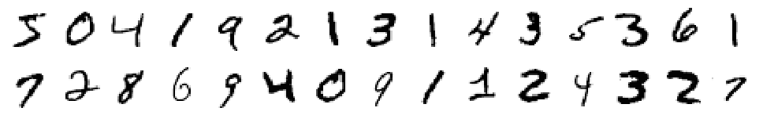

# 12 — MNIST classifier

MNIST is the standard test of whether a neural network implementation
works: 60,000 training and 10,000 test images of 28×28-pixel handwritten
digits, labelled 0-9. It is small enough for laptop CPU experiments, and
large enough to examine how the regularisation and optimisation choices
of the last few chapters affect a model.

This is the first weft example that uses every part of the library at
once: the IDX loader, an MLP with hidden Dense layers, ReLU,
Dropout, Softmax, cross-entropy, Adam, and train/eval mode switching.

---

## 1. The data pipeline

```cpp
X_train = mnist::load_images<float>(data_dir + "/train-images-idx3-ubyte");
y_train = mnist::load_labels       (data_dir + "/train-labels-idx1-ubyte");
Y_train = one_hot<float>(y_train, 10);
```

`load_images` returns a `(784, 60000)` matrix, with one column per image
and pixel values normalised to `[0, 1]`. This is already a reasonable
scale for the Dense layers, so this example skips the Standardizer.
Other centering and scaling conventions are possible; we have not
compared them here.

`load_labels` returns a `vector<int>` of digit indices. `one_hot<float>`
turns that into a `(10, 60000)` matrix with a single 1 per column.



---

## 2. The architecture

```
Dense(784, 256) -> ReLU -> Dropout(0.3)
Dense(256, 128) -> ReLU -> Dropout(0.3)
Dense(128, 10)  -> logits
```

`SoftmaxCrossEntropy` consumes those logits directly. Softmax remains
part of the objective, but is not a separate final layer in this model.

The network has about 235,000 parameters. That is large enough relative
to 60,000 training examples that overfitting is a risk, which is the
regime where dropout is useful.

Two hidden layers keep the example small while giving it more capacity
than the IRIS model. The widths `256 -> 128` and dropout probability
`0.3` are the settings used in this run. We have not established that
they outperform nearby widths or dropout probabilities.

Dropout is applied to the hidden activations. The input pixels and class
logits are left intact. This is a design choice, not a claim that other
dropout placements are invalid. To investigate it, compare otherwise
matched runs on a validation split and report variation across seeds.

---

## 3. The optimiser choice

This run uses Adam at `lr = 1e-3`, with its other settings left at
their defaults and no learning-rate schedule. The recorded example
reaches approximately 98% test accuracy in ten epochs. That result
shows the configuration working; it does not establish an advantage
over tuned SGD. Such a comparison needs separate learning-rate searches,
a validation criterion, and repeated runs.

---

## 4. The training loop in detail

```cpp
SoftmaxCrossEntropy<float> ce;
for (int epoch = 1; epoch <= epochs; ++epoch) {
    net.train();                                  // (a)
    auto idx = shuffled_indices(X.cols(), epoch);

    for (mini-batches) {
        Matrix logits = net.forward(X_batch);
        float L = ce.forward(logits, Y_batch);
        net.backward(ce.backward());
        net.update(opt);
    }

    net.eval();                                   // (b)
    auto [validation_loss, validation_acc] = evaluate(...);
    // Save when validation loss improves.
}
```

The two mode switches are new compared to the IRIS example.

`(a)` puts the network into training mode. Dropout is active and
randomly zeroes 30% of each hidden activation. We corrupt the
activations deliberately, to force the network to be redundant; the
test pass then uses the uncorrupted activations.

`(b)` puts the network into inference mode. Dropout becomes the
identity. The network we evaluate is the full, un-corrupted one.

Without `(b)`, the reported validation accuracy would describe a randomly
masked network and vary with those masks. It would not evaluate the
inference configuration.

**Mini-batch size.** The example uses 128. Batch size changes memory
use, matrix shapes, the number of updates per epoch, and gradient
noise. Timing and validation measurements are needed to choose it for
another model or machine.

The current program holds out 10% of the official training images for
validation. It saves the checkpoint with the lowest validation loss,
loads that checkpoint after training, and evaluates the official test
set once. The initialization and dropout streams follow the supplied
seed.

---

## 5. Train vs test accuracy: reading the gap

The "train acc" reported in the recorded run is the running accuracy during
the training pass, measured with dropout still active. The "test acc"
is measured in eval mode.

Test accuracy can exceed the running training accuracy, especially
early in training. Dropout is active during the training pass, and the
weights also change throughout that pass. The test evaluation uses one
fixed set of weights with dropout disabled. These are different
measurement conditions, so the gap alone is not an overfitting test.

For a cleaner comparison, evaluate both training and validation data in
eval mode after an epoch. Use validation performance to investigate
early stopping or regularisation. Repeatedly consulting test accuracy
for those choices would make it part of model selection.


---

## 6. Running it

You need the four uncompressed MNIST IDX files. The download script
in `data/` fetches them from a reliable mirror:

```
chmod +x data/download_mnist.sh
./data/download_mnist.sh
```

Then from `build/`:

```
make
./examples/mnist_classifier              # uses ../data/mnist
./examples/mnist_classifier /some/path   # or pass a path
./examples/mnist_classifier /some/path 42 mnist.wnet  # seed and checkpoint
```

The recorded example reaches about 98% test accuracy after ten epochs.
Your result and runtime depend on initialization, hardware, compiler
options, and the matrix backend. [Chapter 20](20_performance.md)
discusses the performance choices.

---

## 7. What's missing

A more complete MNIST classifier would do the following, which we
deliberately omit:

- **Repeated seeds.** The current program already uses validation
  checkpoint selection and one final test evaluation. Repeat that
  procedure across declared seeds when comparing configurations.
- **Learning-rate schedule and augmentation.** A schedule, small
  translations, and rotations are possible experiments. Measure
  their effect on validation data instead of assuming an accuracy gain.
- **ConvNets.** Convolution gives the model access to spatial
  structure that this flattened MLP does not encode. It is covered in chapters
  [21](21_from_matrices_to_tensors.md) and [22](22_convnets.md) (4-D
  tensors, Conv2D, MaxPool), applied there to CIFAR-10.

This example is a check of the training machinery, not a benchmark
against the best MNIST systems. Its next use in the book is visual:
digits let us inspect reconstructions and latent interpolations before
working with spectra.


## Further reading {#sec-12-mnist-further-reading}

The MNIST database and the first convolutional and fully connected
results on it are described in [@lecun1998gradient].
