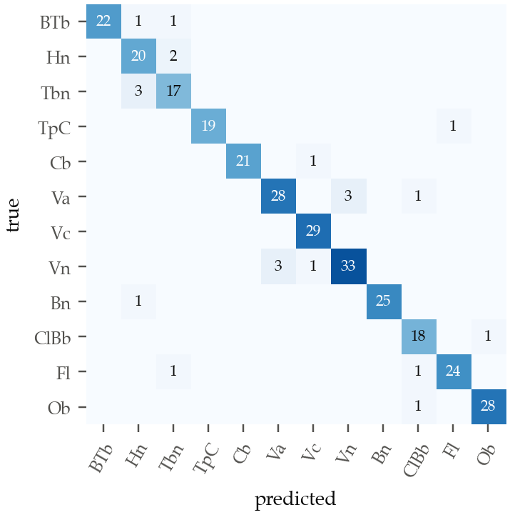

# 15 — Musical instrument classifier (TinySOL)

This chapter applies the audio pipeline to a classification task.
TinySOL is 1,532 WAV files (fetch them with
`data/download_TinySOL_2020.sh`), each a single note from one of 12
orchestral instruments. The first dash-delimited token of the
filename is the instrument class. The task is to predict the
instrument from the audio.

This is the first weft example that builds its own dataset from raw
files. It is split across two tools so that the slow feature
extraction step does not repeat on every classifier iteration.

---

## 1. Why two tools

Feature extraction is the slow part. Each WAV file is framed,
windowed and passed through the FFT more than a hundred times, then
(for MFCC) through the mel filterbank and the DCT. Across the 1,532
files this takes 20 to 30 seconds on a laptop. Training on the
extracted features takes from a fraction of a second to a few
minutes, depending on the features (section 7).

With everything in one binary, every change to the classifier would
repeat the slow extraction first. The workflow is therefore split:

```
extract_features <data_dir> <output.feat> [logmag|mfcc] [averaged|per_frame]
sound_classifier <feature_file>
```

The extractor runs once per (dataset × feature_type × mode)
combination. The model can then be changed and retrained as many
times as needed. This is the standard ETL-then-train pattern, used in
most machine-learning projects.

---

## 2. Extraction modes

### Averaged (one feature per file)

This is the original mode: STFT, then an energy-weighted average
across frames, giving one fixed-length vector per file. It is compact
and fast, and it gives the baseline result. The network architecture
is sized to the feature dimension.

### Per-frame (one feature per non-silent frame)

For each WAV file we keep every non-silent STFT frame as its own
training example. The feature dimension is the same as in averaged
mode (2049 for logmag, 13 for MFCC), but there are about 135 times as
many rows (207,633 frames from the 1,532 files).

The consequences are:

- There is more training data per file, so the network's parameters
  are better constrained and it overfits less.
- The network can learn from the instrument's temporal evolution
  (attack, sustain and release) instead of seeing only the
  time-averaged spectrum.
- At inference, predictions are aggregated across all frames of a
  test file by averaging softmax outputs and taking argmax. This is
  ensembling, and on TinySOL it accounts for most of the 3 to 5 points
  that per-frame mode gains.
- The same per-frame features are what the audio VAE of
  [chapter 19](19_audio_vae.md) trains on.

The cost is that the cache file is about 135 times larger (1.7 GB for
logmag) and an epoch has as many times more iterations. Each
iteration costs the same, since the architecture is unchanged.

On TinySOL the averaged mode reaches about 95% test accuracy with
log-mag features and 93% with MFCCs. Per-frame mode reaches about
98% with either (section 7).

---

## 3. File leakage and the split by file

In per-frame mode, frames from the same file are not independent.
They share most of their spectral character. If frames are split at
random into train and test, frames from the same SOL file end up on
both sides, and the network can memorise specific files at the level
of frames. The test accuracy is then inflated.

The fix is to split by file_id, not by frame: 20% of the files are
chosen for the test set, and all of their frames go with them. The
cache stores a `file_id` per row for this purpose, and
`group_train_test_split` in `Data.h` does the split by file.

For averaged mode the distinction does not matter, because each row
is its own file by construction. The same function handles both
cases: in averaged mode the file_ids are `{0, 1, 2, ...}` and the
result is a regular random split.

---

## 4. Per-file aggregation at evaluation time

Evaluating a trained network in per-frame mode has these steps:

1. Forward-pass all test frames through the network in batches.
2. Group the resulting softmax outputs by `file_id`.
3. Average the softmax outputs across frames of each file.
4. Argmax on the averaged vector to get a per-file prediction.
5. Compare to the file's true label.

This is test-time ensembling. Each frame gives a slightly noisy
probability distribution over classes. Averaging across all frames of
a file cancels the frame-level noise and gives a much sharper
file-level prediction.

The reported "test acc (per file)" is computed with this aggregation.

---

## 5. Confusion matrix

After training, we print a `K × K` confusion matrix over the test
set. Rows are the true class and columns are the predicted class. The
diagonal holds the correct counts, and the off-diagonal entries show
specific confusions.

This is more informative than a single accuracy number. With 12
instruments it can show, for example:

- Violin and viola confused with each other at a high rate. This is
  a structural problem with the representation: their overlapping
  pitch ranges and similar spectral envelopes are nearly
  indistinguishable in features averaged over time.
- Brass instruments confused with one another but not with strings.
  The network has learned the broad timbre family but separates the
  individual instruments poorly.
- Scattered off-diagonal entries. These are mostly model noise.

For SOL the dominant confusions are within instrument families. A
human listener would have the same difficulty with isolated notes.



---

## 6. The cache format (v2)

`FeatureCache.h` provides `save_features` and `load_features`. The
file format:

```
"WFED"  magic                          (weft feature dataset)
uint32  version = 2
uint32  feature_dim
uint32  n_samples (or n_frames in per_frame mode)
uint32  n_classes
uint32  per_frame (0 or 1)
length-prefixed string  feature_type   ("mfcc", "logmag", ...)
length-prefixed strings  class_names[] (n_classes of them)
float[feature_dim * n_samples]         column-major
int32[n_samples]                       labels
int32[n_samples]                       file_ids
```

Header integers are little-endian, assembled byte by byte, so they
do not depend on the host's byte order. The bulk payload is in native
byte order. A cache extracted on one machine and loaded on a machine
with the other byte order has scrambled floats, so this must be
avoided.

The version changed from 1 to 2 to add `per_frame` and `file_ids`.
A v1 cache cannot be loaded and must be regenerated with
`extract_features`.

---

## 7. Results for each combination

| feature | mode      | test accuracy | training time |
|---------|-----------|---------------|---------------|
| mfcc    | averaged  | 92.8%         | 0.1 s         |
| mfcc    | per_frame | 98.0%         | 9 s           |
| logmag  | averaged  | 95.1%         | 5 s           |
| logmag  | per_frame | 97.7%         | 13 min        |

These are single runs on TinySOL with the default settings. With 306
test files one file is a third of a percentage point, and the
initial weights are not seeded, so the last digit changes from run
to run. Per-frame logmag is the slowest because a 2049-wide first
layer is applied to 135 times as many rows.

Per-frame mode gains 3 to 5 points over averaged mode. In averaged
mode logmag is ahead of MFCC by 2 points. In per-frame mode the two
are equal, and logmag costs a hundred times more training time.

---

## 8. What is not implemented

- **CQT (Constant-Q Transform).** Logarithmically spaced bins give
  better pitch invariance. It would be worth adding as a third
  feature type alongside `logmag` and `mfcc`.
- **Per-class weighting.** If some instruments have many more samples
  than others, the loss is dominated by the majority classes.
- **Data augmentation.** Pitch shifting, time stretching and additive
  noise are standard ways to raise accuracy further.
- **Spectrogram-based ConvNet.** Instead of averaging or aggregating
  frame-level features, the full (frames × bins) spectrogram is fed
  to a 2D ConvNet. This is the largest improvement available, and
  the usual way to handle time in audio. ConvNets arrive in
  [chapter 22](22_convnets.md) and are applied to spectrograms in
  [chapter 23](23_convvae.md), but a spectrogram classifier is not
  implemented.

The current pipeline combines the other components built so far (WAV
I/O, FFT, windowing, mel filterbank, DCT, Adam, dropout, train/eval
mode, standardisation, group-aware splitting, a small binary
serialisation format) into a complete classifier.


## Further reading

The instrument samples come from the Studio On Line recordings;
the dataset and its role in computer-assisted orchestration are
described in [@cella2020orchidea]. Orchidea, the orchestration system
the samples were collected for, is described in [@cella2022orchidea].
