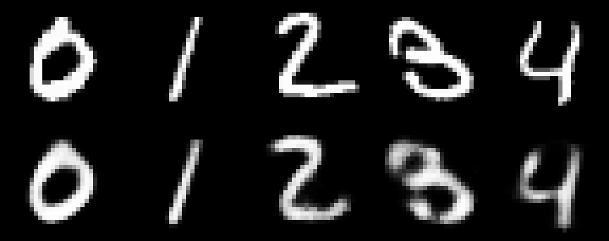
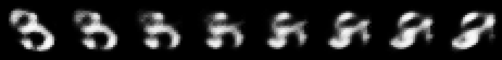

# 16 — Autoencoders

Everything so far has been *supervised*: we give the network an input
and a label, and it learns the mapping. An autoencoder uses no labels.
It receives an input and is asked to reproduce that same input at the
output, but the signal must first pass through a narrow middle layer.
That bottleneck encourages a compact representation. It does not by
itself prevent memorization or guarantee that the code captures useful
structure; reconstructions and new inputs let us examine what was
learned.

This chapter covers the small primitives the autoencoder needs (MSE
loss and the Sigmoid activation), the autoencoder itself, and the
demo: reconstructing MNIST digits and morphing one digit into another
through the latent space. The demos are written out as BMP images by
a small `Bmp.h` writer (uncompressed 24-bit BMP: two headers and raw
pixels, the image counterpart of the WAV reader), so we can look at
the results as images instead of ASCII art.

---

## 1. MSE loss

For classification we used cross-entropy, which expects a probability
distribution. For an autoencoder reconstructing pixel intensities,
the natural objective is squared error, which measures how far each
output pixel is from the corresponding input pixel.

$$
L = \frac{1}{2N}\sum_{n=1}^{N}\sum_i(P_{i,n}-T_{i,n})^2.
$$

`P` is the prediction, `T` the target, `N` the batch size. We sum over
features (the 784 pixels) and average over examples. This is the same
convention as cross-entropy, where the per-example averaging factor
`1/N` lives in the loss so the layers never need to know the batch
size.

The factor of `1/2` is a convenience: differentiating the square
brings down a 2 that cancels it, leaving the gradient

$$
\frac{\partial L}{\partial P} = \frac{P-T}{N}.
$$

The gradient is the (averaged) error: each output is pushed toward its
target in proportion to its error. `tests/test_mse.cpp` checks the
known value, the gradient formula, and agreement with a numerical
gradient.

Because we sum over 784 pixels, the loss value looks large (tens,
early in training) compared to the classifier's cross-entropy (single
digits). This is a consequence of the summing-over-features
convention. What matters is that it decreases. Multiply by 2, divide
by 784, and take the square root to get a per-pixel RMS error in the
same [0, 1] units as the pixels.

---

## 2. Sigmoid activation

MNIST pixels lie in [0, 1]. If the decoder's last layer were linear,
it could output any real number, including negatives and values above
1, which are not valid pixel intensities. The logistic sigmoid maps
any real input into (0, 1):

$$
\sigma(x) = \frac{1}{1+e^{-x}}.
$$

so the reconstruction is always a valid intensity. Its derivative has
a compact form:

$$
\sigma'(x) = \sigma(x)(1-\sigma(x)).
$$

Since the forward pass already computed `Y = sigma(Z)`, the backward
pass reuses `Y` directly: `dZ = dY * Y * (1 - Y)`, element-wise. Like
ReLU, it is an element-wise activation, so the Jacobian is diagonal
and backward reduces to a Hadamard product. It has no parameters.

(Sigmoid appears again as the gate nonlinearity if we ever build
recurrent layers, and the same logistic shape is the binary case of
the softmax we already have.)

---

## 3. What an autoencoder is

An autoencoder consists of an encoder and a decoder:

```
encoder:  784 -> 128 -> ReLU -> 32 -> ReLU -> 16        (the bottleneck)
decoder:  16 -> 32 -> ReLU -> 128 -> ReLU -> 784 -> Sigmoid
```

The input (784 pixels) is reduced to a 16-number *latent code*, then
expanded back to 784 pixels. The loss is MSE between the output and
the original input. The training objective contains no labels; the
input is its own target.

The bottleneck reduces the dimension available to represent an image.
MNIST digits have repeated structure: strokes, curves, slant, and
thickness. A useful encoder can exploit those regularities rather than
represent every pixel independently. Thinking of the codes as
coordinates on a manifold is a helpful picture, but the reconstruction
objective does not guarantee such a coordinate system. A sufficiently
flexible model can also memorize a finite training set.

The bottleneck layer itself is **linear** (no activation). This leaves
the latent coordinates signed and unbounded. It is an implementation
choice; it does not ensure that distances in latent space correspond
to perceptual similarity.

---

## 4. Why two Networks instead of one stack

A plain autoencoder is a deep stack, so we could express it as a
single `Network` from 784 to 784. Building it as two separate
`Network`s, an encoder and a decoder, lets us call the halves
independently:

- `enc.forward(x)` → the latent code for an input
- `dec.forward(z)` → the image for a latent code

This separation makes the generative demos possible. A single stack
gives only input-to-output: there is no way to read the latent code
or to feed the decoder a code of our own choosing.

Training across two Networks needs no new library code. The latent
code is passed from one to the other:

```cpp
Matrix z      = enc.forward(Xb);        // 784 -> 16
Matrix recon  = dec.forward(z);         // 16  -> 784
float  L      = mse.forward(recon, Xb); // target = the input itself

Matrix dRecon = mse.backward();         // dL/d recon
Matrix dz     = dec.backward(dRecon);   // dL/d z, updates decoder grads
enc.backward(dz);                       // updates encoder grads (return ignored)

dec.update(opt);
enc.update(opt);
```

The chain rule applies across the boundary: the decoder's backward
returns the gradient with respect to its input (the latent code),
which is the gradient the encoder's backward needs as its incoming
signal. One `Adam` instance optimises both networks. It keys its
per-parameter state on each weight matrix's address, so it can track
parameters from any number of networks at once.

---

## 5. Demo 1 — reconstruction

After training, we run a few test digits through `enc` then `dec` and
write the originals and their reconstructions to a BMP image
(`ae_reconstructions.bmp`) using the `Bmp.h` writer: top row the
originals, bottom row the reconstructions, each digit scaled up for
easier viewing. In this example, reconstructions are recognisable but
slightly blurry. Both limited model capacity and the squared-error
objective can contribute: uncertain details may be reconstructed as an
average. Compression can suppress some noise, but this model was not
trained on noisy/clean pairs and is not guaranteed to denoise.



---

## 6. Demo 2 — latent interpolation

This demo shows that the latent space is meaningful and not only a
means of compression. Take two test digits, say a 3 and an 8. Encode
both to get codes `za` and `zb`. Then walk a straight line between
them in latent space and decode each point:

$$
z(t) = (1-t)z_a + tz_b,\qquad 0\leq t\leq 1.
$$

The example decodes eight evenly spaced values of $t$.

Decoding each `z(t)` produces a sequence of images that morph the 3
smoothly into the 8, written side by side into `ae_interpolation.bmp`.
The intermediate images are decoded latent blends, not direct pixel
averages. In the displayed example they remain digit-like. Other
endpoint pairs may pass through poor reconstructions; a continuous
decoder guarantees continuous changes in its output, not recognisable
images everywhere along the path.

Generation relies on this continuity. If decoding arbitrary points in
latent space yields plausible outputs, then we can *sample* new points
and get new outputs: new digits, or in the audio version, new timbres.
The plain autoencoder does not specify where to sample, which is the
limitation considered next.



---

## 7. The limitation of the plain autoencoder

A plain autoencoder's latent space has no enforced shape. The encoder
is free to place codes wherever is convenient: clusters in some
places, voids in others, arbitrary scales on each axis. A line between
encoded inputs can leave the regions covered during training, and an
arbitrarily sampled code has no reason to land in one of those regions.
Good reconstruction alone therefore does not give us a sampling
procedure.

The **variational autoencoder** (next chapter) introduces a distribution
for each encoded input and a regularizer that encourages those
distributions to remain close to a chosen prior, here a unit Gaussian.
We can then draw `z` from that prior and decode it. This makes sampling
part of the model, but it does not guarantee that every draw is
plausible. Decoded grids and random samples will show how well the
regularization worked.

Once generation works on MNIST, the same method applies to the audio
goal: train the encoder/decoder on per-frame spectra instead of
pixels, and the latent space becomes a space of timbres to interpolate
through and sample from.


## Further reading {#sec-16-autoencoder-further-reading}

Training a network to reproduce its input through a narrow layer, and
what the resulting codes are good for, is the subject of
[@hinton2006dim].
