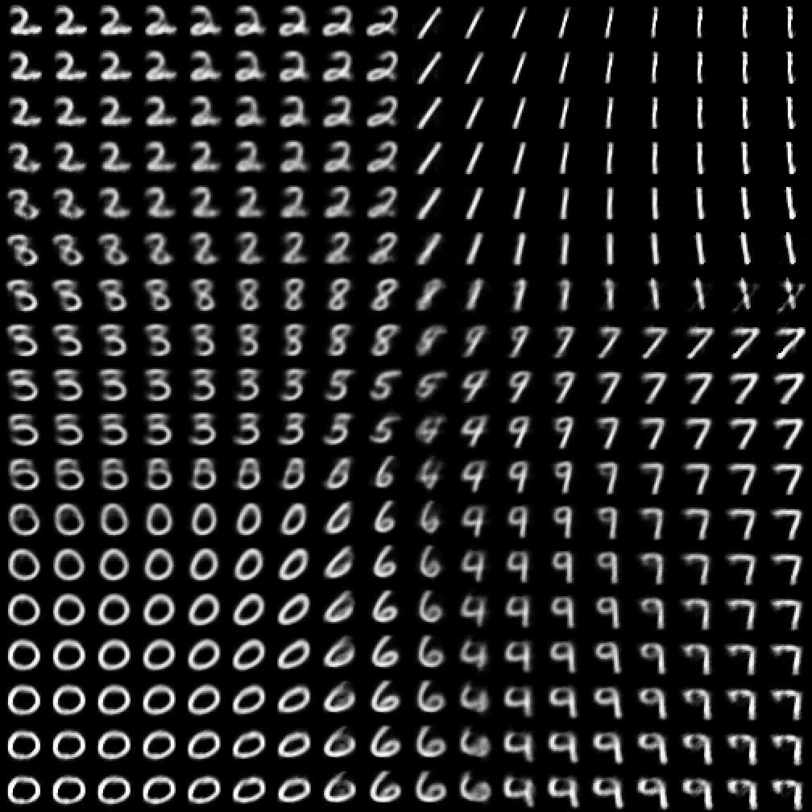

# 17 — Variational autoencoders

The plain autoencoder reconstructed digits and produced useful
interpolations for selected pairs. It did not tell us where to draw a
new latent code. Its reconstruction loss leaves the arrangement of
codes largely unconstrained.

The variational autoencoder adds an explicit probabilistic model and a
prior from which we can sample. Its architecture is similar, but the
encoder now produces a distribution and the objective balances
reconstruction against a regularization term.

---

## 1. Encode a distribution, not a point

Instead of mapping an image to a single latent code, the VAE's encoder
maps it to a Gaussian distribution over latent space: a mean `mu` and
a variance `sigma^2`, one of each per latent dimension. An input then
occupies a small region of latent space instead of a single point.
During training we draw a sample from that region and decode it, so
reconstruction is evaluated at varying latent points. This encourages
useful output near the encoded means. The decoder is continuous, as in
the plain autoencoder, but neither continuity nor this sampling step
guarantees plausible images throughout latent space.

In code, the encoder emits `2 * LATENT` numbers instead of `LATENT`.
We slice the output: the first `LATENT` rows are `mu`, the next
`LATENT` rows are `logvar`.

We use `logvar` (the log of the variance) and not the variance itself
because a variance must be positive, which would mean constraining the
network's output. The logarithm is unconstrained (any real number is
a valid log-variance), so the network can output it freely, and we
recover a standard deviation that is guaranteed positive with
`sigma = exp(0.5 * logvar)`.

---

## 2. The reparameterisation trick

We need to draw `z ~ N(mu, sigma^2)` and train `mu` and `sigma`
through the resulting reconstruction. A sampling API that simply returns
a random draw does not expose the differentiable path needed by our
manual backward pass. We make that path explicit by rewriting the draw.

The trick moves the randomness out of the path. Instead of sampling
`z` directly, draw a standard normal `eps ~ N(0, I)`, which depends on
no parameters, and compute

$$
z = \mu+\sigma\odot\varepsilon,\qquad
\varepsilon\sim\mathcal{N}(0,I).
$$

This `z` has the distribution we wanted (`N(mu, sigma^2)`), but now
`eps` is an input, like the image. The path from `mu` and `sigma` to
`z` is plain differentiable arithmetic:

$$
\frac{\partial z_d}{\partial \mu_d}=1,\qquad
\frac{\partial z_d}{\partial \sigma_d}=\varepsilon_d.
$$

So gradients flow through `mu` and `sigma` as usual, and the only
random quantity, `eps`, is a leaf with nothing to learn. This is what
makes VAEs trainable by ordinary backprop.

In the example the trick is written out explicitly between the encoder
and decoder and not hidden in a layer, so that the three lines
(`sigma = exp(0.5*logvar)`, draw `eps`, `z = mu + sigma*eps`) are
visible.

---

## 3. The KL divergence term

Sampling encoded distributions does not on its own pull their
arrangement toward any particular global shape: the encoder
could still place its Gaussians anywhere. So we add a second loss
term that measures how far each encoded Gaussian `N(mu, sigma^2)` is
from the standard normal `N(0, I)`, and penalises the distance. The
measure is the Kullback–Leibler divergence, and for two Gaussians it
has a closed form:

$$
D_{\mathrm{KL}}
= \frac{1}{2}\sum_d
\left(\mu_d^2+\sigma_d^2-1-\log\sigma_d^2\right).
$$

Minimising it pulls every `mu` toward 0 and every `sigma^2` toward 1.
That is, it pulls all the per-image Gaussians toward the same unit
Gaussian centred at the origin. Reconstruction resists making every
encoded distribution identical, because the decoder needs information
about each input.

The prior gives generation a defined procedure: draw `z ~ N(0, I)` and
decode it. The KL term encourages overlap between encoded distributions
and this prior. How well prior samples decode is an empirical question;
the objective does not guarantee gap-free coverage or plausible output
for every sample.

The KL gradients we push back into the encoder are (per element; the
`1/B` matches MSE's batch-averaging convention so that the two loss
terms combine consistently):

$$
\frac{\partial L_{\mathrm{KL}}}{\partial \mu_{d,n}}
= \frac{\mu_{d,n}}{B},\qquad
\frac{\partial L_{\mathrm{KL}}}{\partial\operatorname{logvar}_{d,n}}
= \frac{\sigma_{d,n}^2-1}{2B}.
$$

---

## 4. The total loss, and the balance

$$
L = L_{\mathrm{reconstruction}}+\beta L_{\mathrm{KL}}.
$$

These two terms pull in opposite directions, and the VAE depends on
the balance between them. Reconstruction favours a latent that carries
as much information about the input as possible (ideally a unique
precise code per image, as in the plain AE). KL favours codes that all
look like generic `N(0, I)` noise (carrying no information). The
useful solution must retain information while remaining compatible with
the prior.

The likelihood assumption determines the interpretation of the
reconstruction term. For a Gaussian decoder with fixed unit variance,
its negative log-likelihood is half the summed squared error, plus a
constant. That matches our MSE convention: sum over pixels and average
over examples. With `beta = 1` and sampled latents, the total estimates
the negative evidence lower bound (ELBO), up to that constant.

Changing the feature normalization, the assumed decoder variance, or
the loss reduction changes the relative scale of the two terms.
`beta` deliberately changes their balance. Increasing it strengthens
prior regularization and can reduce reconstruction quality; it does not
guarantee disentangled coordinates. Decreasing it can improve
reconstruction while weakening prior sampling. The failure modes are:

- **Posterior collapse**: if KL dominates (or the decoder is powerful
  enough to do without the latent), the encoder outputs
  `mu = 0, sigma = 1` for everything. The KL term goes to zero and the
  latent carries nothing. KL falls toward 0 while reconstruction stays
  high. A small bottleneck is not a guarantee against collapse; inspect
  both the KL term and whether changing the latent changes the output.
- **Ignored prior**: if reconstruction dominates, KL stays large, the
  encoded Gaussians drift away from `N(0, I)`, and sampling degrades
  back toward AE-like voids.

Stable losses are useful diagnostics, but they do not establish useful
generation. Inspect reconstructions, random prior samples, and the
effect of changing `beta` alongside the two loss curves.

---

## 5. Latent dimension: quality vs. the manifold picture

This example has a useful trade-off. A 2D latent lets us draw a decoded
grid and inspect which regions produce recognizable digits. It also
restricts the independent directions of variation available to the
decoder. The reported 2D run gives blurry reconstructions and around
0.20 RMS error per pixel, compared with roughly 0.12 for the
16-dimensional plain autoencoder in chapter 16. These runs also differ
in objective, so the comparison does not isolate latent dimension.

The example defaults to LATENT = 2, so that the manifold picture can
be drawn. Setting it to 16 is an experiment in greater latent capacity
(the grid is then skipped). Compare reconstruction and sampling rather
than assuming both will improve. Squared error also favors conditional
means when detail is uncertain, which can blur output. A different
decoder likelihood, such as per-pixel Bernoulli, would change the
reconstruction objective and needs its own comparison.

## 6. The demos

**Reconstruction** uses `mu` directly (no sampling), giving one
deterministic code for each image. This is a convenient evaluation
choice, not generally the posterior mean of the decoded image.

**Latent grid** (only drawn when `LATENT == 2`) is the demo the plain
AE couldn't produce. We sweep `z` over a regular grid covering
`[-2.5, 2.5]^2`, decode each grid point, and tile the results into a
single image. Look for regions of recognizable digits, transitions
between them, and patches that decode poorly. A populated-looking grid
is evidence about the inspected points, not proof that the entire
latent space is well modeled.

(We space the grid linearly for simplicity. The textbook version spaces
it by the inverse normal CDF of evenly-spaced probabilities, which
samples the prior uniformly by probability mass. That gives a slightly
better manifold picture, but it needs a probit function we haven't
written.)

**Latent interpolation** works in any dimension: encode two digits to
their means, walk the straight line between the two codes, and decode
each step. One digit morphs into another through latent space. This is
the same idea as the AE's interpolation, now with prior regularization.
The plausibility of the intermediate images still needs inspection.

**Random samples** draw `z ~ N(0, I)` and decode. These are images the
encoder never produced from any real input, so they are generated and
not reconstructed. Most are readable digits; a few are blends from
samples landing between clusters.

---

## 7. Application to audio

Nothing in the VAE is image-specific. Replace the 784-pixel input with
a per-frame magnitude spectrum and the same encoder, decoder,
reparameterisation and KL term learn a latent space of spectra instead
of digits. Then:

- interpolating encoded spectra gives candidate timbre transitions;
- sampling `z ~ N(0, I)` gives new candidate spectra, whose quality
  depends on the learned model;
- rendering a sequence of those spectra requires phase and an inverse
  STFT, as well as a choice of how the codes evolve in time.

This is the morphing application. The model is complete. The remaining
piece is the audio processing, STFT/iSTFT with overlap-add, added in
[chapter 19](19_audio_vae.md).

## Further reading {#sec-17-vae-further-reading}

The variational autoencoder and the reparameterisation trick are
[@kingma2014vae]. The effect of weighting the KL term, the `beta` of
this chapter, is studied in [@higgins2017betavae].
