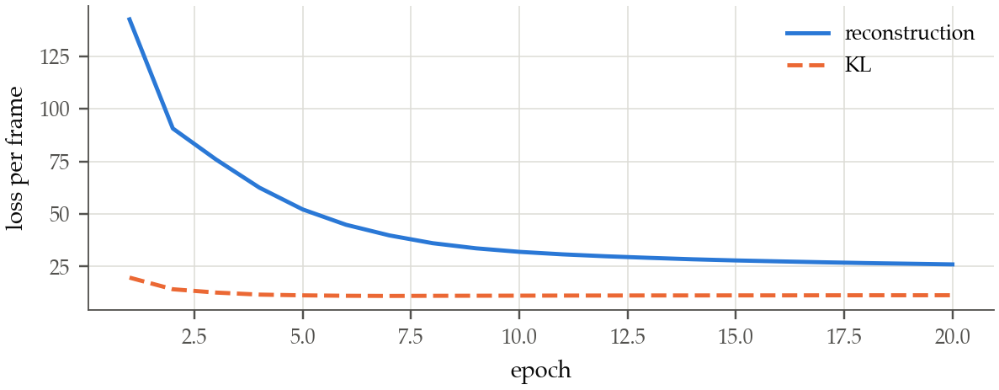

# 19 — The audio VAE: training, serialization, and remapping

We have a working VAE (chapter 17) and WAV I/O (chapter 14). This
chapter adds the last audio component, `STFT.h`, a short-time
Fourier transform and its inverse by weighted overlap-add, whose
round trip reproduces a signal to the quantisation floor. It then
connects the STFT to the VAE: we train the VAE on the spectra of
orchestral sounds, save it, and examine how it transforms a new input
through that learned representation.

The chapter covers model serialization (so we train once), the
log-magnitude pipeline (which turns audio into VAE input and back
again), and the remap application.

## 1. Serialization: train once, apply many times

Training on the TinySOL frames is slow (a 2049-wide first layer over
hundreds of thousands of frames). We don't want to retrain every time
we remap a different song, so the network can now save and load its
weights. This is the same separation of slow training from fast
iteration that we already use for features.

The design is polymorphic, like `update(Optimizer&)`. `Layer` has two
new virtuals with no-op defaults:

```cpp
virtual void save_params(std::ostream&) const {}
virtual void load_params(std::istream&) {}
```

Activations inherit the no-ops (they have no parameters). `Dense`
overrides them to write and read its weight matrix and bias.
`Network::save` writes a small header (a `WNET` tag, a version, and the
layer count) and then asks each layer to serialise itself; `load` does
the reverse. `load` does not build the graph. It fills an
already-constructed network of the same architecture. Loading into
the wrong shape throws (the layer count and each matrix's dimensions are
checked). For this reason the application tools rebuild the identical
encoder/decoder before calling `load`.

New weight files include version, scalar width, and layer configuration
checks. Same-shaped activation substitutions are rejected. The audio
applications also supply a shared `AudioModelConfig` description, which
records the sample rate, FFT/hop, window, latent size, and, for the
convolutional model, mel settings. Loading requires the same metadata.

Legacy version-one network files can still be read through the low-level
API without a metadata requirement. Their format cannot verify these
settings. Known-compatible old audio weights can be re-saved with
verified metadata; the application does not guess it. These are still
weight files: Adam's moments and random-generator state are not saved.

The scheme needs no `dynamic_cast` and no central registry of layer
types. The convolutional layers of chapter 22 use the same two-method
scheme in their own parallel hierarchy.

## 2. The log-magnitude pipeline

Audio is a waveform; the VAE works on fixed-length vectors. The STFT
converts one to the other: it slices the signal into overlapping
frames, windows each frame, and takes its FFT. Each frame becomes a
complex spectrum, from which we take the **magnitude** (how much energy
at each frequency) and the **phase** (the alignment of each frequency).
We feed the VAE magnitude only. This is a simplifying representation
choice: phase carries structure too, but this model does not learn it.
Rendering therefore needs a separate phase choice (see §4).

We feed **log-magnitude**, `log(1 + |X|)`, not raw magnitude.
Spectral magnitudes span a large dynamic range (a few loud harmonics
among many near-silent bins), and raw MSE would be dominated by the
loud bins. The logarithm compresses that range into roughly `[0, 6]`,
so the network's capacity is used across the whole spectrum. This is
the same `logmag` feature the classifier used, so the existing
`extract_features ... logmag per_frame` produces the training set, and
the remap computes the same feature formula from its own STFT. This
requires matching the sample rate, Hann window, FFT size, hop, and
channel handling. Version-three caches record the framing settings and
the audio applications validate them against `AudioModelConfig`. They
require 44.1 kHz input. Matching a formula alone does not establish
matching preprocessing.

The VAE is the MNIST one with bigger layers and a 32-D latent. We
don't need a 2-D latent here, because there is no manifold picture to
draw and only quality matters. One change: the decoder's output layer
is linear, not sigmoid. Pixels were bounded to `[0, 1]`; log-magnitudes
are non-negative and unbounded, so no squashing is needed. The apps
clamp the decoder output to `>= 0` and invert with `expm1` to recover
magnitude.

## 3. Training (`train_audio_vae`)

`train_audio_vae` reads the per-frame logmag cache, ignores the labels
(this is unsupervised), and runs the VAE training loop from chapter 17:
the encoder emits `mu` and `logvar`, we reparameterise
`z = mu + sigma*eps`, decode, compute the loss `= MSE + beta*KL`, and
backpropagate the reconstruction and KL gradients into the encoder. At
the end it saves `<prefix>.enc` and `<prefix>.dec`.

This is also the first training run heavy enough to need attention to
performance: the frames can be subsampled (an optional argument, off
by default; adjacent STFT frames are highly redundant) and the model
is checkpointed periodically, so an interrupted long run does not lose
everything. These techniques, and the parallelised matmul they rely
on, are the subject of chapter 20.

### Recorded v0.2.0 run {#sec-19-recorded-v020}

The new run uses 1,433 complete training recordings and reserves
75 other recordings for validation, matching the synthesis experiment
in [chapter 24](24_differentiable_synthesis.md). Another 24 short
recordings are excluded by that protocol. Extraction produces
196,804 training frames. No frame of a validation recording enters
this cache.

The settings are 20 epochs, batch 256, no frame subsampling,
initialization seed 1, reparameterization seeds starting at 1234,
and Adam at 0.001. We use the final checkpoint, with the epoch count
fixed before listening to the reserved recordings.

The final training reconstruction term is 26.0208 and KL is 11.3713
at `beta = 1`. The reconstruction term is half the sum of squared
errors across 2,049 log-magnitude bins per frame, averaged over the
batch. It is not an error per bin or a waveform-quality score.



Their scalar ratio alone does not tell us whether the prior is well
matched: gradients and resulting samples matter too. The listening
applications decode encoded means rather than prior samples. If prior
sampling is poor, changing `beta` is one experiment, with a possible
cost to reconstruction.

Training reports 232.9 seconds on an Apple M3 Max with Apple Clang 16,
`-O3`, and Accelerate, requesting one BLAS thread. Other recorded runs
overlap this one, so this is a reproduction record rather than a
performance comparison. The [protocol](../book/experiments/README.md)
contains exact commands, data hashes, and logs.

### Reserved recordings {#sec-19-reserved-recordings}

The [listening player](audio/index.html) includes three recordings
chosen before training: cello A4 mf, trumpet A4 pp, and flute D5 pp.
All three belong to the validation list. They illustrate other
recordings of known instruments; they do not measure transfer to a
new instrument or recording setup.

For a numerical comparison, form magnitude spectrograms with Hann
4,096 and hop 1,024. Compare the original with the application's
written waveform after fitting one global magnitude gain:

$$
R=\frac{\sum (|X|-g|Y|)^2}{\sum |X|^2},\qquad
g=\frac{\sum |X||Y|}{\sum |Y|^2}.
$$

The sums cover bins and complete frames of the common-length signals.
Gain alignment removes a scalar level difference; it cannot assess
loudness fidelity. The application waveform already contains its
edge fades, normalization, PCM quantization, and any clipping.

| Reserved recording | Gain-aligned spectral residual | Raw output samples at PCM rails |
| --- | --- | --- |
| Cello A4 mf | 22.57% | 0.378% |
| Trumpet A4 pp | 7.40% | 0.052% |
| Flute D5 pp | 1.99% | 0.201% |

These percentages describe a spectral discrepancy for three specific
files, not perceived quality or a corpus average. The original-level
residuals and all gains are retained in the record. RMS matching the
listening copies changes their level; it cannot undo the raw
application's clipping.

## 4. Remapping (`vae_remap`): a learned spectral transformation

This is the application that the audio chapters lead to. Take any
input (a song, a voice) and pass each of its magnitude frames through
the VAE. Training on TinySOL biases the reconstruction toward the
spectra represented in that dataset. An unfamiliar frame, such as a drum
hit or vocal formant, may therefore change substantially.

"Projection onto a manifold" is an intuition for this application, not
an optimization the forward pass performs. The encoder does not search
for a nearest orchestral sound, and the decoder is not guaranteed to
stay within the training distribution for an unfamiliar code. We inspect
and listen to the result as a learned transformation.

The pipeline:

1. STFT the input → complex frames.
2. For every frame, compute `log(1 + magnitude)` and store the phase.
3. Stack all frames into one `2049 x n_frames` matrix and run a single
   batched `encode -> mu -> decode`. (One large matmul is faster than
   thousands of one-column forward passes, and the `Network` is already
   built for batches, columns = examples.)
4. For each frame, invert the decoder's log-magnitude (`expm1`, clamp
   `>= 0`) and recombine it with that frame's **original phase**.
5. iSTFT, a short fade at both ends, and normalisation to the 99th
   percentile of the absolute sample values.

Step 4 reuses the input's phase while changing its magnitude. This
avoids estimating phase, but it does not guarantee a consistent STFT or
artifact-free audio: the phase and the altered magnitudes may no longer
fit one another across frames. Retaining source phase is a useful
reference choice, especially when the magnitude change is modest.

## 5. What to expect from the remap

This is a dense network on magnitude frames with reused phase. Its
output is a demonstration of learned spectral remapping. Each frame is
treated independently, so the model has no temporal context for an
attack or a transition. The training corpus influences its timbre but
does not restrict the decoder to producing only valid TinySOL spectra.


## 6. Generating (`vae_generate`): interpolation and sampling

The remap could reuse the input's phase. The two generative
applications produce a magnitude with no obvious phase, so each has to
borrow one. Both avoid iterative phase estimation
(Griffin-Lim [@griffin1984signal]), trading some fidelity for
simplicity.

**Interpolation** morphs between two real sounds. Encode both to latent
means, then for each output frame blend the codes,
`z = (1-t)*z_A + t*z_B`, with `t` going linearly from 0 at the first
output frame to 1 at the last, and decode. The phase is reused from
sound A, frame by frame. Because interpolation has a real source to
borrow phase from, it sounds nearly as clean as the remap on sustained
material. Coherence degrades as `t` approaches 1 and A's phase no
longer matches B's magnitude, and it is worst on transients.

**Sampling** is the purely generative case: draw `count` anchor latents
`z ~ N(0, I)` and move linearly through them across the donor's
duration. Frame 0 lands on anchor 0, the last frame lands on anchor
`count-1`, and interior frames interpolate between adjacent anchors, so
one output passes through several invented timbres. This also shows
the continuity of the latent space, a characteristic property of the
VAE: nearby latents decode to similar sounds. The cost comes from
phase. There is no source at all, so we borrow the phase of the donor
sound frame by frame. This is the crudest path: the donor's phase only
fits the frequency bins where the donor had energy, and the sampled
magnitude generally peaks elsewhere, so the mismatch produces
artifacts. It is the case a real phase-reconstruction method
(Griffin-Lim, or a neural vocoder) would improve most. We include it
because hearing a timbre drawn from the prior, however rough, is the
reason to have a VAE rather than a plain autoencoder.

There are two distinct quality questions. The VAE must produce useful
magnitude frames, and the renderer must turn a sequence of them into a
waveform. A sequence of nonnegative frames is not necessarily a
consistent STFT magnitude. Borrowed phase addresses rendering only
approximately, while model errors remain in the magnitudes themselves.
Here we leave those errors visible rather than adding a learned
waveform renderer.

## 7. Limitations {#sec-19-audio-vae-limitations}

A weak `beta` keeps the latent loosely organised. This matters little
for the remap but does matter for sampling and interpolation, where a
better organised latent would morph and sample more smoothly. The
deepest limitation is that the per-frame model has no notion of time:
timbre that should evolve coherently is reconstructed one independent
frame at a time. Both limitations point toward a convolutional VAE
that sees the 2D time-frequency structure of a spectrogram
([chapter 23](23_convvae.md)), and toward models of sequences
(chapters 25 to 29).

The audio quality is low. The remap, the interpolation and the
sampling all run, and they show what a latent space can be used for,
but a small network trained with squared error produces blurred
spectra, and the phase is borrowed from another sound. Chapter 23
improves the model; it does not change that.
[Chapter 24](24_differentiable_synthesis.md) gets clean audio by a
different route, with a network that controls a synthesiser instead of
producing spectra.


## Further reading {#sec-19-audio-vae-further-reading}

The model is the variational autoencoder of [@kingma2014vae] applied to
spectrogram frames of the samples described in [@cella2020orchidea].
Estimating phase for a magnitude spectrogram, which we avoid by
borrowing one, is the reconstruction problem approached iteratively by
[@griffin1984signal]. The learned alternative, a network that produces
the waveform directly, begins with [@vandenoord2016wavenet].
