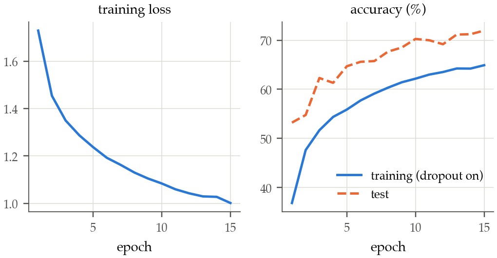
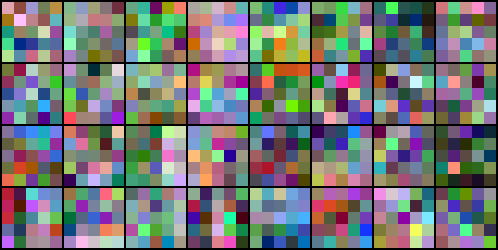

# 22 — Convolutional networks

For the first twenty chapters we worked only with dense (fully
connected) layers. Dense layers handle the MNIST classifier, the Iris
classifier, the audio VAE on spectrograms, and any other case where
the input is a flat vector of features and it does not matter which
feature sits next to which. They have one specific limitation: they
have no notion of spatial structure. A dense layer treats every input
neuron as exchangeable with every other one. Apply the same fixed
permutation to the pixels of every MNIST image (the rows of the batch
matrix) and a dense MLP, retrained on the permuted data, will reach
the same accuracy. This shows that dense layers use nothing about the
2-D arrangement of pixels. For images, that means most of the
structure is unused.

This chapter is about the layer that does use it: **convolution**. We
motivate it, derive its forward and backward math, explain the
technique (`im2col` + matmul) that makes it run fast on a CPU, and
then train a small ConvNet on CIFAR-10. We look at the accuracy and
also at the learned first-layer kernels, which can be displayed as
images and show what the network has learned to treat as an edge.


## 1. Why dense MLPs are wrong for images

**Parameter count.** A 32×32 RGB CIFAR-10 image has 32·32·3 = 3072
input pixels. A single dense layer with 1024 hidden units would have
3072 × 1024 ≈ 3.1 million weights in the first layer alone. Most of
those weights relate pairs such as pixel (3, 7, red) and
pixel (28, 14, blue), whose joint relevance has no meaning for natural
images. The weights are mostly wasted.

**No translation invariance.** Suppose we have a perfectly trained
dense MLP that classifies cats correctly. We take a cat image and
shift every pixel one column to the right (wrapping the rightmost
column to the left, say). To a human, it is the same cat. To the dense
MLP, every input has changed: the pixel that was at index 5 of the
input vector is now at index 6, and the weight matrix holds no
information that those two positions are spatially adjacent. The MLP
has to learn the concept of "cat" separately at every possible
translation. That is very inefficient and, in practice, doesn't
generalise.

**No use of locality.** In natural images, pixels close together in
space are far more likely to be related than pixels far apart. Edges,
textures and object parts are all local. A dense layer cannot
represent this prior; it has to learn locality from data, using
millions of weights that mostly should be zero. It is better to build
the locality into the architecture.


## 2. The convolution operator

A 2-D convolution at one output position computes

    y[h, w]  =  sum over (kh, kw) of  x[h + kh, w + kw] · k[kh, kw]

where `k` is a small kernel (3×3 or 5×5 are typical) and the same
kernel `k` is applied at every output position `(h, w)`. The operator
has these properties:

- **Local connectivity.** Each output value `y[h, w]` depends on a
  small neighbourhood of the input (only the K² pixels under the
  kernel), not on the whole image. A 3×3 kernel uses 9 input pixels
  per output, regardless of how big the image is. The parameter count
  no longer grows with the image size.

- **Weight sharing.** The same kernel `k` slides across the whole
  image. There are K² weights in total for the entire layer, not per
  position. A 3×3 kernel has 9 numbers. (More precisely:
  K² × C_in × C_out, but the spatial part is K² regardless of image
  size.)

- **Translation equivariance.** Shift the input one pixel right and
  the output shifts one pixel right. The kernel and the computation
  are unchanged. The network has the right structural prior for
  natural images built in.

Translation equivariance is the most fundamental of these.
Equivariance is not invariance: the network's output shifts when the
input shifts, it does not stay the same. This is what we need in the
early layers, because the final layers (after pooling and flattening)
can become invariant on top of equivariant features.

**Multi-channel extension.** Real images have channels (R, G, B), and
intermediate feature maps have many channels (32, 64, sometimes
hundreds). So the kernel is a 3-D object, `(C_in, K, K)`, that is
applied to a `C_in`-channel patch and produces one scalar output. To
produce `C_out` output channels, we use `C_out` independent 3-D
kernels. A conv layer with C_in=3, C_out=32, K=5 has

    32 × 3 × 5 × 5 = 2400 weights

plus 32 bias values (one per output channel). This is very small
compared to the millions of weights of a dense layer.


## 3. Padding and stride

Padding and stride let convolution work with images of any size.

**Padding** adds zero-pixels around the input border so the output can
have the same spatial dimensions as the input. A 3×3 kernel with no
padding (`p = 0`) takes a 28×28 input to a 26×26 output (it can't be
centred on the boundary pixels). With `p = 1`, a 28×28 input gives a
28×28 output ("same" padding). Whether to use it depends on the
architecture; it is common in early layers, so that the spatial
dimensions only shrink at the pooling steps, not inside the conv
itself.

**Stride** controls how far the kernel moves between output positions.
Stride 1 (the default) puts an output at every input pixel. Stride 2
puts one at every other pixel, which halves the output spatial size.

The combined output formula is

    H_out = (H_in + 2p - K) / s  +  1

and the same for W. A 32×32 input with K=5, p=2, s=1 gives
H_out = (32 + 4 − 5) / 1 + 1 = 32, so the size is preserved. K=3, p=1,
s=1 also preserves it. K=3, p=1, s=2 halves it:
H_out = (32 + 2 − 3) / 2 + 1 = 16.


## 4. im2col: making convolution fast on a CPU

The math above describes the operation. A direct implementation, with
seven nested loops over (n, out_C, h_out, w_out, in_C, kh, kw), works
but is slow. Seven-deep loop nests use the cache poorly, and we have
already put significant work into making `Matrix::operator*` fast
(parallel rows, optional BLAS dispatch). We would like to reuse the
matmul for convolution.

The technique that allows this is called **im2col**, short for
image-to-column. It rearranges the input so that the convolution
becomes a single matrix multiplication.

For every output position `(n, h_out, w_out)`, the input
patch under the kernel is a 3-D chunk of shape `(C_in, K, K)`. Flatten
that chunk into a column of length `C_in · K · K`. Stack the columns
side by side across all output positions:

    im2col matrix:  (C_in · K · K)  ×  (N · H_out · W_out)

Now reshape the kernel from `(C_out, C_in, K, K)` into a matrix of
shape `(C_out, C_in · K · K)`, with one row per output channel, the
row being that channel's flattened kernel. Then

    Z = W · im2col            shape: (C_out, N · H_out · W_out)

and the entire convolution is one matrix multiply. All our earlier
matmul optimisations (`std::thread` parallelisation, optional BLAS)
apply without further work. This is the approach the Caffe framework
made standard, and one of the algorithms GPU libraries such as cuDNN
choose from.

The cost is the memory of the temporary `im2col` matrix, which is K²
times larger than the input. At our scale (CIFAR-10 with small
batches) this fits easily in memory. For very large images or
deep networks, more sophisticated schemes (Winograd, FFT-convolution)
become competitive; we don't need them.

**Backward via col2im.** The backward pass reverses the procedure. Given
the gradient `dY` of shape `(N, C_out, H_out, W_out)`:

1. Reshape `dY` into `dZ` of shape `(C_out, N · H_out · W_out)`.
2. Parameter gradients are matmuls:
   `dW = dZ · im2col^T`  (kernel gradient),
   `db = sum-along-columns of dZ`  (bias gradient).
3. For the gradient w.r.t. the input, compute `dCol = W^T · dZ`. This
   has the shape of the original im2col matrix.
4. **col2im** folds `dCol` back into the input shape, accumulating
   the contributions at every input pixel that was touched by more
   than one output position. When stride is less than kernel size,
   that is most pixels.

The accumulation is easy to get wrong. If you write `=` instead of
`+=` in the col2im loop, the gradient is wrong, with no error
reported, for every conv layer with stride < K. The numerical gradient
check in `tests/test_conv2d.cpp` catches this kind of bug.


## 5. Pooling

After every conv layer (or every couple) we reduce the spatial size,
both to build invariance to small shifts on top of the equivariant
features and to cut the computational cost of subsequent layers. The
standard tool is **max-pooling**: take a window (typically 2×2) and
emit the maximum value.

The forward pass needs no explanation. In the backward pass, the
output depended on one input pixel per window (the one with the max
value). Every other pixel in the window contributed nothing, so the
gradient `dY` for that output cell goes entirely to that input pixel.
We store its index during forward and look it up during backward.

With non-overlapping windows (stride = pool size, the typical case
that halves each dimension), each input pixel is the maximum at most
once. With overlapping pooling (stride < pool size), an input pixel
can be the maximum in multiple output windows, and the gradients
accumulate. This is the same `+=` issue as in conv backward, and the
same test pattern catches it.

Max-pool has zero learnable parameters and runs in O(N · C · H · W).
It is cheap and robust, and every conv classifier uses it.


## 6. Connecting conv to dense

Putting convolution and pooling together: a small conv stack reduces a
32×32×3 image to a `(C, H', W')` feature map, say `(64, 8, 8)`. To
predict a class probability vector, we need a vector output, not a
3-D feature map. The standard step is **flatten**: turn the 3-D feature
map into a 1-D vector and feed it to a dense classifier.

In our library, this is where the data structure changes: `Tensor4D`
becomes `Matrix`. We do this with an explicit free function
`flatten(Tensor4D) -> Matrix`, not a hidden reshape inside a unified
tensor type. The conv stack is one `ConvNetwork`; the dense head is
another `Network`; the example connects them.
[Chapter 21](21_from_matrices_to_tensors.md) discusses why this is the
right choice for a teaching library.

The classic AlexNet shape, in our library, looks like this:

```cpp
ConvNetwork<float> conv;
conv.add<Conv2D>(  3, 32, 5, 1, 2);  conv.add<ReLU4D>();  conv.add<MaxPool2D>(2);
conv.add<Conv2D>( 32, 64, 3, 1, 1);  conv.add<ReLU4D>();  conv.add<MaxPool2D>(2);

Network<float> dense;
dense.add<Dense>(64 * 8 * 8, 256);  dense.add<ReLU>();  dense.add<Dropout>(0.5f);
dense.add<Dense>(256, 10);
dense.add<Softmax>();
```

The forward pass at every training step:

```cpp
Tensor4D<float> feat  = conv.forward(X);            // (N, 64, 8, 8)
Matrix<float>   flat  = flatten(feat);              // (4096, N)
Matrix<float>   probs = dense.forward(flat);        // (10, N)
```

The backward pass mirrors it, with `unflatten` doing the reverse
reshape on the gradient.


## 7. What the library provides

The conv work in this chapter and the previous one added these
headers:

- **`Tensor4D.h`**: the 4-D dense tensor in NCHW layout, with
  element access, `apply`, `fill`, randomisation, and a `hadamard`
  free function for element-wise products in backward computations.
  Covered in [chapter 21](21_from_matrices_to_tensors.md).

- **`ConvLayer.h`**: the abstract base class for conv-stack layers,
  parallel to `Layer` for the dense world.

- **`ConvNetwork.h`**: the container, parallel to `Network`.
  Supports `add<L>(args...)`, `forward`/`backward`/`update`,
  `summary()`, `save`/`load` (with a distinct `WCNV` magic so a conv
  file cannot be loaded into a dense network by mistake).

- **`Conv2D.h`**: the convolution itself, with He initialisation, the
  im2col forward and col2im backward, configurable kernel size, stride,
  and padding. Verified by numerical gradient check on `dX`, `dW` and
  `db` at stride 1, and on `dX` again at stride 2.

- **`ReLU4D.h`**, **`MaxPool2D.h`**, **`Flatten.h`**: the supporting
  layers. `MaxPool2D` has a numerical gradient check too, because
  its backward (routing through the cached argmax) is the kind of
  indexing logic that is easy to get wrong.

- **`CIFAR10.h`**: the loader for the CIFAR-10 binary files
  (`load_cifar10`, `cifar10_train_paths`, `cifar10_test_paths`).

The whole conv library is covered by tests that pass at full numerical
precision (double-precision gradient checks, 1e-6 relative tolerance).
If those pass, the math is right. If they fail, no change of
architecture will compensate.


## 8. The CIFAR-10 classifier

CIFAR-10 is the standard image dataset one step harder than MNIST:
60,000 32×32 colour images split into 50,000 training and 10,000 test,
with 10 classes (airplane, automobile, bird, cat, deer, dog, frog,
horse, ship, truck). It is hard enough to be a real test and small
enough not to need a GPU: a small ConvNet trained on CPU reaches about
72% test accuracy in under half an hour.

We deliberately skipped MNIST for the conv classifier. The dense MLP
chapter already classified MNIST at ~98% test accuracy; a conv version
would make the same point in a more complicated way. CIFAR-10 shows
the advantage of convolution: on data where a dense MLP struggles to
get above ~50% accuracy, the small ConvNet reaches well above 70%.

**The architecture** we use is `cifar_conv.cpp`:

```
input  (N, 3, 32, 32)
  Conv2D(3 -> 32, k=5, p=2)     -> (N, 32, 32, 32)     <-- 5x5 first layer
  ReLU4D
  MaxPool2D(2)                  -> (N, 32, 16, 16)
  Conv2D(32 -> 64, k=3, p=1)    -> (N, 64, 16, 16)
  ReLU4D
  MaxPool2D(2)                  -> (N, 64, 8, 8)
---- flatten ----                -> (4096, N)
  Dense(4096, 256)
  ReLU
  Dropout(0.5)
  Dense(256, 10)
  Softmax
```

The dense part has a hidden layer and dropout because the simpler
version, a single `Dense(4096, 10)`, overfitted badly: 99% accuracy
on the training set and 60% on the test set.

On the design choices:

- **5×5 kernels in the first layer**, 3×3 in the second. The first
  layer is the one we visualise, and 5×5 RGB tiles are much more
  legible than 3×3 ones. The deeper layer can use the smaller kernel
  because it operates on richer features (32 channels rather than 3).
  This is the same reasoning that led Krizhevsky's AlexNet to use 11×11 at
  the first layer (working on 224×224 images), 5×5 next, then 3×3.

- **Two conv blocks**, not three. A third block would raise accuracy
  slightly (78-82% range) but adds another hour of CPU training for a
  marginal improvement. The architecture above is the smallest one
  that shows all the elements of a conv network (locality, hierarchy,
  pooling, dense head) while keeping the iteration time short. It is
  a pedagogical choice; a production CIFAR-10 model would use ResNet
  or something larger.

**Training.** Adam optimizer (lr = 1e-3, defaults), batch size 64, 15
epochs, He-initialised conv kernels, zero-initialised biases, and the
standard CIFAR augmentation (random horizontal flip, random shift of
up to 4 pixels). Run it with

```sh
./examples/cifar_conv  ../data/cifar-10-batches-bin  15  cifar_model
```

and on our machine, built with `make BLAS=1`, it takes about 26
minutes and produces a model that reaches 72% test accuracy.
The training prints loss, train accuracy, and test accuracy each epoch,
and saves a checkpoint after each one, so Ctrl-C is safe.




## 9. Visualising what the first layer learned

The main reason for using CIFAR rather than MNIST was the
visualisation. The companion example `cifar_filters.cpp` loads the
trained model, extracts the first conv layer's 32 5×5×3 filters, and
arranges them in a 4×8 grid BMP. Each filter is normalised
independently to fill [0, 255] so weak and strong filters are both
visible.

What the first layer of a well-trained image network shows:

- **Oriented edge detectors** at various angles (horizontal,
  diagonal, vertical). These look like dark/light gradients across the
  kernel, with high values on one side and low on the other. The
  kernel is effectively a small derivative filter in some direction.
- **Color-opponent blobs.** Red-on-green, blue-on-yellow. The network
  learns this colour structure from the data: nothing in the training
  told it that RGB pixels have any particular meaning, but with
  enough natural images colour opponency appears because it is
  discriminative.
- **Low-frequency centre-surround patterns.** Some filters look like
  blurry blobs that respond to overall brightness or colour in a
  region.
- **A few filters that learned nothing**, which stay close to their
  random initial values and look like coloured noise.

Our 15-epoch model shows this only faintly. In the run reported above
most of the 32 tiles still look like coloured noise at this size, with
structure visible in a few. Longer training makes the patterns
clearer; the accuracy figure, not the picture, is the reliable
evidence that the layer has learned something.

This is the picture that Krizhevsky's AlexNet paper (2012)
[@krizhevsky2012imagenet] and Zeiler & Fergus's *Visualizing and
Understanding Convolutional Networks* (2014) [@zeiler2014visualizing]
made well known. Our version, trained on CPU on a much smaller
architecture and dataset, shows the same qualitative pattern. The
structure comes from the operator and the data, not from the depth or
scale.

The deeper layer is harder to visualise as raw weights, because its
filters operate on the 32-channel output of the first layer rather
than on RGB. Each second-layer kernel is `(32, 3, 3)`, which is not
directly an image. Techniques for visualising deeper layers
(activation maximisation, deconvolutional inversion) exist but are out
of scope here. The first layer learns features, and those features
look like edges and colour patches because that is what is locally
informative in natural images.




## 10. Later chapters

The same Conv2D layer, applied to spectrograms instead of CIFAR
images, gives a **ConvVAE for sound**: the generative architecture of
the dense audio VAE from [chapter 19](19_audio_vae.md), with
convolutional layers in the encoder and decoder. That is
[chapter 23](23_convvae.md): the architecture, the training, the three
applications, and an account of why the audio is still poor.
[Chapter 24](24_differentiable_synthesis.md) then takes a different
route to clean sound, a network that drives a synthesiser. Chapters
25 to 27 build attention and a transformer, and chapters 28 and 29
apply it to recorded sound.


## Further reading {#sec-22-convnets-further-reading}

Convolutional networks trained by backpropagation are
[@lecun1998gradient]; the architecture that established them for
natural images is [@krizhevsky2012imagenet]. The CIFAR-10 dataset is
described in [@krizhevsky2009cifar]. Computing a convolution as one
matrix product over unrolled patches, our `im2col`, is described in
[@chellapilla2006high]. For what the learned filters look like in
larger networks, see [@zeiler2014visualizing].
