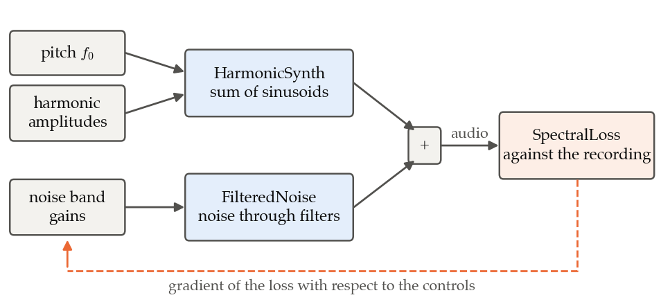
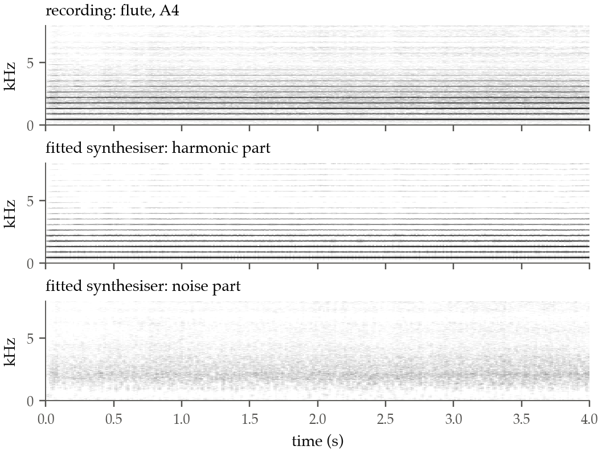
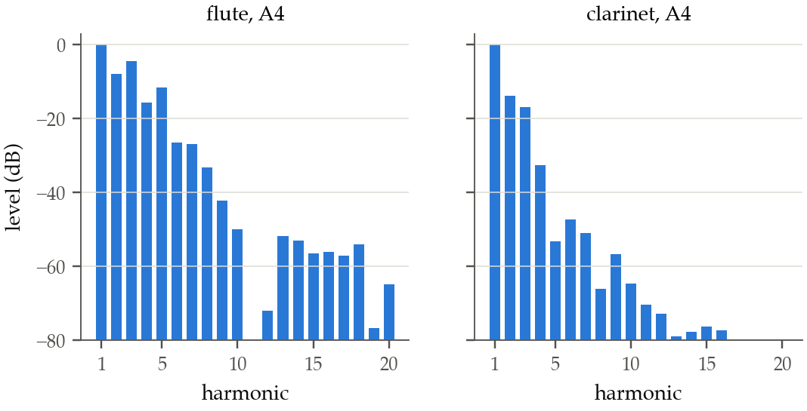
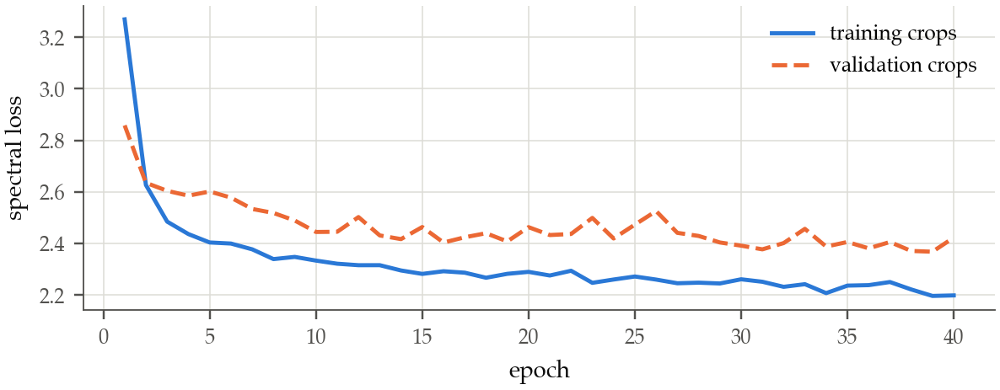

# 24 — Differentiable synthesis: a network that plays a synthesiser

The audio VAEs of chapters [19](19_audio_vae.md) and
[23](23_convvae.md) train, their latent spaces are smooth, and the
three applications run. Next to the recordings they came from,
however, the results sound poor. Several costs remain even with a
better fit: we asked a small network to regenerate a
spectrum from 32 numbers, and then we had to turn that spectrum back
into a waveform. Each step loses fidelity. Squared error makes the
network output the average of plausible spectra, which blurs sharp
harmonic peaks. The magnitudes are paired with the phases of a
different sound. In the convolutional model 64 mel bands are
stretched back to 2049 bins.

This chapter takes a different approach to the same goal. We do not
ask the network for sound. We ask it for the controls of a
synthesiser with a defined family of outputs. The synthesiser is
classical signal processing: a bank of sinusoids at multiples of a
fundamental, plus filtered noise. It has no trainable parameters. The
network never outputs an audio sample. With pitch and the noise
realization fixed, the audio is differentiable with respect to the
amplitude controls. The error measured on that audio can therefore be
propagated back to tell the network how to change the controls.

The idea is known as differentiable digital signal processing, or
DDSP [@engel2020ddsp]. The synthesiser inside it is much older: it is
the harmonic-plus-noise model of spectral modelling synthesis
[@serra1990sms]. This chapter combines the neural networks of the
earlier chapters with signal processing that is standard in audio
work. Each does the part it is suited to.


## 1. The harmonic part

A pitched instrument tone is, to a good approximation, a sum of
partials at `f0, 2 f0, 3 f0, ...`. A flute and a cello playing the
same note differ in how loud each partial is and how that changes in
time. The harmonic synthesiser therefore takes

```
f0[t]      fundamental frequency in Hz, one per control frame
A[k, t]    amplitude of harmonic k+1 at frame t      (K x T)
```

and produces

$$
y[n]=\sum_k a_k[n]\sin((k+1)\phi[n]),\qquad
\phi[n]=\frac{2\pi}{f_s}\sum_{r=0}^{n-1}f_0[r].
$$

Here $f_s$ is the sample rate and $\phi[0]=0$. The sum over harmonics
includes only those below Nyquist.

Controls arrive once every 512 samples (11.6 ms at 44.1 kHz) and are
interpolated linearly up to the sample rate. A harmonic whose
frequency reaches the Nyquist limit is silenced. All of this is
`HarmonicSynth<T>`.

The backward pass is easy because the output is linear in the
amplitudes. Write the interpolation weight of frame `t` as `w_t[n]`.
Then

$$
y[n]=\sum_{k,t} A_{k,t}\,w_t[n]\sin((k+1)\phi[n]).
$$

and the gradient of any loss with respect to one amplitude is a
correlation of the upstream gradient with that amplitude's own basis
signal:

$$
\frac{\partial L}{\partial A_{k,t}}
=\sum_n\frac{\partial L}{\partial y[n]}\,
w_t[n]\sin((k+1)\phi[n]).
$$

No gradient flows to `f0`. Pitch is an input here and is not learned
(section 4 explains where it comes from).

The sines are not computed with `sin()`. From `sin(phi)` and
`cos(phi)` the recurrence
`sin((k+1)x) = 2 cos(x) sin(kx) - sin((k-1)x)` gives every harmonic
with one multiplication each. The running phase is accumulated in
`double` even when the library is instantiated with `float`. Its
rounding error is amplified by the harmonic number, up to a hundred
times for the top harmonics, and a float would lose the low bits they
need.


## 2. The noise part

Not everything in an instrument tone is periodic. The breath of a
flute, the bow noise of a cello and the hiss inside an attack cannot
be built from harmonics. `FilteredNoise<T>` produces them as white
noise shaped by a filter that changes over time.

```
M[b, t]    gain of frequency band b at frame t       (B x T)
```

The `B` bands (we use 65) are spread evenly from 0 Hz to Nyquist, and
the gain at an FFT bin is interpolated from the two nearest bands, so
`M` is a smooth spectral envelope with `B` control points. The filter
is applied in the short-time Fourier domain. A fixed, seeded noise
signal is cut into overlapping windowed frames. Each frame is
transformed with the FFT, multiplied by the gains, transformed back,
windowed again and overlap-added. Analysis and synthesis both use a
square-root Hann window, so that their product is a Hann window and,
at 50% overlap, unit gains return the noise unchanged.

As in the harmonic part, the output is linear in the controls, and
the backward pass is the adjoint of the forward pass: window the
upstream gradient under each frame, FFT it, and correlate with that
frame's noise spectrum. Bins `k` and `N-k` share one gain, so their
gradients add.

The two parts are summed. The whole synthesiser therefore has
`K + B` numbers per control frame, 165 in our configuration, and is
linear in all of them.


## 3. The spectral loss

The synthesiser's output must be compared with a recording. A
sample-by-sample comparison is the wrong test. Two sine waves of the
same frequency and loudness but different starting phase sound
identical, yet their sample-wise difference can be as large as the
signals themselves. Our synthesiser starts every harmonic in sine
phase, and a real instrument does not. A waveform loss would be
dominated by a difference that cannot be heard.

What the ear compares is closer to the magnitude of the short-time
spectrum. `SpectralLoss<T>` compares that. For one FFT size `N`, with
a Hann window and hop `N/4`:

```
S_y = | STFT(y) | / sum(window)          (same for the target x)
L_N = mean over all bins and frames of
        | S_y - S_x |  +  | log(S_y + eps) - log(S_x + eps) |
```

The linear term is dominated by the loud partials. The log term makes
quiet components count too: the decay of a note, the weak upper
harmonics, the noise floor.

The test suite shows the difference with three signals: a sine, the
same sine shifted in phase, and a sine at another pitch. The spectral
loss gives 0.198 for the phase shift and 2.83 for the pitch change.
The sample-wise error cannot tell the two cases apart.

One FFT size is a compromise: long windows resolve frequency and blur
time, and short windows do the opposite. The loss is therefore summed
over several sizes. This is what "multi-scale" means.

**Backward.** For one frame the spectrum is

```
Y[k] = sum_i  y[i] * w[i] * exp(-2 pi j k i / N)
```

so

```
d|Y[k]| / dy[i]
    = w[i] * Re( conj(Y[k]) / |Y[k]| * exp(-2 pi j k i / N) )
```

Collect the per-bin loss gradients `g[k] = dL/d|Y[k]|` into
`C[k] = g[k] * conj(Y[k]) / |Y[k]|`, zero outside bins `0..N/2`. The
frame's gradient is then `w[i] * Re(FFT(C)[i])`, and the frames
overlap-add into the gradient of the whole signal. This takes one FFT
per frame, the same cost as the forward pass. All three backward
passes, and the chain of synthesiser into loss, agree with finite
differences to about `1e-8` in `tests/test_synth.cpp`.


## 4. Pitch is an input

The synthesiser needs `f0`, and a small error there has a large
effect. If `f0` is off by 10 cents (0.6%), partial 40 is off by the
same 0.6%, which at 17 kHz is 100 Hz, several FFT bins away from the
real partial. The synthesised partial and the recorded one then do
not overlap, and no choice of amplitude can make them match.

For the instrument samples we use, the note name is in the file name
(`Fl-ord-A4-mf.wav`), and `note_to_hz` turns it into a frequency. That
is correct to the nearest semitone only: players tune a little sharp
or flat and string players add vibrato. `refine_f0` therefore starts
from the nominal pitch and, frame by frame, searches 60 cents either
side of it for the fundamental whose harmonics best match the peaks
of the measured spectrum. For each candidate it adds the spectrum's
magnitude at `f, 2f, 3f, ...`. The search is confined to less than a
semitone around a known pitch, so there is no octave ambiguity.
Octave ambiguity is the hard part of general pitch tracking, and its
absence is the reason we do not need a full pitch tracker.




## 5. First experiment: no network

Before training a network to produce the controls, we measure how
good the synthesiser can sound. `synth_fit` does this. It treats the
controls themselves as the parameters: the amplitude of every
harmonic and the gain of every noise band at every frame, about
60,000 numbers for a six-second note. The loop is the one used by
every example in this book, with the synthesiser in place of the
network:

```
controls -> HarmonicSynth + FilteredNoise -> audio
audio, recording -> SpectralLoss -> dL/d(audio)
dL/d(audio) -> synthesiser backward -> dL/d(controls) -> Adam
```

This is a reference for the network: how well can direct optimization
fit this target with the chosen synthesiser and loss? A global optimum
over the same controls would bound the attainable loss, but a finite
Adam run is not proof of that optimum. Another initialization or
optimization procedure could improve on the fit.

```
synth_fit fit  Fl-ord-A4-mf.wav  A4  flute
```

Four hundred iterations take about two minutes per note. At the end
the program prints the **spectrogram difference**: the energy of the
difference between the magnitude spectrograms of the resynthesis and
of the recording, divided by the energy of the recording's. It is
under 0.5% for flute, clarinet, trumpet, violin, trombone, bassoon
and a low cello note, and 3% for a cello note with wide vibrato. The
noise part is small for these sustained tones, under half a percent
of the energy.

This is analysis and resynthesis, the same family as the phase
vocoder [@flanagan1966phase] and sinusoidal modelling
[@mcaulay1986sinusoidal]: measure a sound's partials, then rebuild it
from them. Gradient descent is an unusual way to do the analysis, but
nothing here goes beyond what classical methods already do.
`synth_fit morph` and `synth_fit blend`, which interpolate between
the fitted controls of two notes, are the classical cross-synthesis
of two sets of partials. What the network adds is described in
section 8.






## 6. The pitch period sets the time scale

The first fits of low notes were bad. A bassoon A2 came out with its
harmonics switching on and off from frame to frame, and a spectrum
that no longer matched the recording. The first three explanations
we tried were wrong.

The pitch was not the cause: a long FFT shows the bassoon's partials
at 110.00 Hz. The optimiser's settings were not the cause. The
missing phases were not the cause either. We tested this with a
synthetic note that the synthesiser can reproduce exactly (twenty
harmonics of 110 Hz, in sine phase; `synth_fit synthetic` writes it).
The fit of that note flickered too, and its spectrogram difference
was 16%. The loss surface itself therefore had bad solutions. The
causes were the following.

**Controls that move too fast.** A control frame lasts 11.6 ms and
one period of A2 lasts 9 ms. If a harmonic's amplitude may change as
fast as the waveform repeats, switching it on and off becomes another
way of shaping the waveform, and the optimiser uses it. The fix is to
store the controls at knots spaced so that one knot spans about four
periods of the note, and to interpolate between them. For A4 the rule
changes nothing. For A2 it places a knot every fourth frame. With
that change alone, the synthetic note's amplitudes came out steady
and the spectrogram difference fell to 0.1%.

**Windows that are too short.** A window shorter than a few periods
cannot separate neighbouring harmonics. What it measures then depends
on their relative phases, which the synthesiser does not control.
Given the same synthetic note with random phases, the fit returned
0.000 and 0.040 for two harmonics whose true amplitudes were 0.15 and
0.10. It had given up correct amplitudes to obtain a better waveform
shape. The fix is to use only FFT sizes of at least 2.5 periods: 256
to 4096 for A4, 1024 to 8192 for A2. With both fixes the same note is
recovered as 0.050, 0.150, 0.300, 0.100, which are the true values,
and the bassoon's resynthesis matches the recording to 0.4%.

Both rules state that the time scale of the model has to be set by
the pitch period and not by a fixed number of milliseconds. They
apply unchanged to the network.


## 7. The network

`synth_train` trains one network to produce controls from pitch,
loudness, and one of the instrument identities in the training corpus.
For every control frame it reads 26 numbers:

- **Pitch**: `log2(f0 / 440)`, scaled.
- **Loudness**: the level of the sound around the frame, in dB, at
  nine time offsets from 8 frames before to 8 frames after. One value
  would not be enough, because an attack and a decay pass through the
  same level and need different spectra.
- **Instrument**: a learned 16-dimensional vector, one per instrument.

The instrument vector is our first use of `Embedding<T>`, a lookup
table of trainable vectors indexed by an integer. Its forward pass
copies the selected column. Its backward pass adds the incoming
gradient into that column. Nothing tells the network what a flute is.
Twelve vectors start as random numbers and are moved by the same
gradient descent as every other parameter until they are useful.

The network itself is the simplest in the book: three hidden layers
of 256 units with ReLU, 181,000 parameters in all. It outputs 166
numbers per frame, which a small "head" turns into controls:

```
amp   = act(o[0] - 3)                     one overall amplitude
h_k   = act(o[1+k])   below Nyquist, else 0
A_k   = amp * h_k / sum_j h_j             harmonic amplitudes
M_b   = act(o[1+K+b] - 5)                 noise band gains
act(x) = 2 * sigmoid(x)^ln(10) + 1e-7
```

The two offsets make an untrained network, whose outputs are near
zero, start quiet.

Splitting the harmonics into "how loud overall" and "how the loudness
is shared" lets the network learn timbre separately from dynamics.
The activation is always positive and close to exponential for small
values, so equal steps in the network's output are roughly equal
steps in decibels.

One training step takes a batch of notes, cuts a random 1.5-second
crop from each, runs the network once over all their frames, and then
runs the synthesiser and the loss for each note on its own thread. The
gradients are propagated back through the synthesiser, through the
head, into the network and into the instrument vectors.

```
synth_train train  data/TinySOL_2020  synth_model  60
```

In the earlier recorded run, 60 epochs on 1,508 usable notes of
12 instruments, with 75 reserved for validation, took 17 minutes.
Its training loss fell from 3.25 to 2.19 and validation loss from
2.87 to 2.37. Those are historical results; the new fixed run below
uses 40 epochs and the v0.2.0 initialization.

### Recorded v0.2.0 run {#sec-24-recorded-v020}

The new run uses the same 1,532-file TinySOL package. The example
excludes 24 short notes, then reserves every twentieth accepted
recording at offset ten for validation: 1,433 training recordings
and 75 validation recordings. Both the file order and all hashes
are in the [experiment record](../book/experiments/README.md).
The dense VAE in [chapter 19](19_audio_vae.md) uses these same
training files.

We fixed 40 epochs before running, with batch 14, 128-frame
training crops, initialization seed 1, embedding seed 7, and
crop/shuffle RNG 1234. Validation uses fixed crops beginning at
control frame 4. The final network is used for the listening
examples; validation did not select the number of epochs.

Training loss changes from 3.2691 to 2.1986; validation changes
from 2.8580 to 2.4227. These losses concern different crop
distributions, and this validation set is not an untouched final
test set. The example also uses all accepted notes when estimating
the typical loudness used by its gesture generators. Its timbre
weights train only on the training notes.



The reported training-loop time is 532 seconds on an Apple M3 Max,
using Apple Clang 16, `-O3`, and Accelerate with a requested BLAS
thread limit of one. Pitch analysis and loading occur before that
timer. Other experiments overlap part of the run, so this timing
does not establish a speedup over the earlier run.


## 8. What the network adds

A direct fit can only rebuild the note it was fitted to. The network
has learned a function from pitch, loudness and instrument to sound,
and a function can be evaluated where there is no recording.

```
synth_train resynth synth_model  cello.wav  A4  Fl   out.wav
synth_train note    synth_model  Fl Vc  A4  6  flat  out.wav
synth_train note    synth_model  Vn Vn  A4  5  vibrato  out.wav
synth_train phrase  synth_model  ClBb  out.wav
```

- **Timbre transfer.** `resynth` takes the pitch and loudness curves
  of a recording and plays them with any instrument's vector: a cello
  note, with the cello's own vibrato and bow changes, as a flute.
- **Morphing.** Because an instrument is a point in a
  16-dimensional space, we can move between two points while a note
  is held. The intermediate timbres belong to no instrument.
- **Notes that were never played.** A crescendo, a vibrato, a
  glissando over an octave, a phrase of eight notes: the training
  data contains only single sustained notes, so all of these are
  new. So are notes outside an instrument's range, such as a flute at
  A2.

None of this is concatenated from recordings. Every sample is
produced by the oscillators and the noise filter.


## 9. Results and limitations

In the earlier recorded listening examples, the output sounded clean
compared with the VAEs. There is no phase
problem because the synthesiser generates coherent sinusoids, and no
inversion problem because there is no spectrogram to invert. The
loudness envelope and the pitch, vibrato included, are reproduced
closely.

In that sixty-epoch run, the timbre was less faithful than a direct
fit. The reported losses were 2.4
for the network on unseen notes against 0.4 to 1.6 for the direct
fits. The network has learned a somewhat generic version of each
instrument. On held-out notes the trumpet and trombone are close to
the recordings. The clarinet comes out with a full set of harmonics
although a real clarinet's even harmonics are weak. A pianissimo
flute is too bright. A fortissimo double bass is 7 dB too quiet. A
longer run might reduce the difference, but that needs to be measured.
The network fits many notes with shared parameters and must generalize
to held-out inputs; the direct fit optimizes a separate set of controls
for each target.

The limits of the approach come from the synthesiser:

- **One pitched voice.** A chord, a drum, a noisy texture or a
  recording of several instruments is outside what a harmonic series
  plus filtered noise can describe.
- **Pitch has to be known.** We read it from the file name and refine
  it. Applying the model to an arbitrary recording needs a real pitch
  tracker.
- **The sound is regular.** A harmonic synthesiser driven by smooth
  controls sounds like a very good additive synthesiser: stable,
  clean, and without the roughness of a real attack.

The method does not produce a new kind of sound. The synthesiser is
the one signal processing has used for decades, the training loop is
the one we have used since chapter 9, and the only new idea is that
the first can be placed inside the second. The network supplies a
mapping from musical controls to synthesis parameters. The synthesiser
supplies a waveform renderer with explicit assumptions about pitch,
partials, and noise. Those assumptions make the output easier to
interpret while limiting the sounds it can represent.

### A shared listening comparison {#sec-24-shared-listening}

The new [listening examples](audio/index.html) compare this network
with the dense VAE on three validation recordings fixed before
training. Both models use the same training-file list. The network
receives the target's measured pitch and loudness; the VAE receives
its frame magnitudes and reuses its phase. Their supplied information
and output representations differ.

The following values use the gain-aligned magnitude-spectrogram
residual defined in [chapter 19](19_audio_vae.md), evaluated on the
raw application outputs. Each is a percentage of the target
magnitude-spectrogram energy.

| Reserved recording | Dense VAE | Network-controlled synthesiser |
| --- | --- | --- |
| Cello A4 mf | 22.57% | 28.77% |
| Trumpet A4 pp | 7.40% | 26.68% |
| Flute D5 pp | 1.99% | 1.55% |

For the cello, fitting controls directly for 400 iterations produces
a 2.93% gain-aligned residual in 113.3 seconds. This fit uses the
target throughout optimization. The network's larger residual
therefore motivates investigating its shared mapping and training;
it does not establish a global optimum for the direct fit.

The network has a smaller residual than the VAE on the flute case
and a larger one on the other two. This small comparison gives no
general ranking of the models or their musical usefulness. A
renderer with coherent oscillator phases can still have the wrong
spectral envelope. The VAE's borrowed phase, normalization, and
observed clipping also remain part of its result.


The STFT-only reference in the prologue retains both magnitude and
phase. Its independent double-precision round trip has maximum
sample error below `1.1e-13` where window-power coverage exceeds
`1e-8`; uncovered boundaries are excluded from that particular
sample-error statement. This separates transform inversion from
the learned reconstruction problem.

The file guide records the source identities and RMS gains.
Listen for the attack, pitch motion during the sustain, and release,
then decide which differences matter for the transformation you
want to make. The prescribed phrase and flute/cello morph
demonstrate control beyond reconstructing a single target recording.

The next chapters return to architecture. Everything so far has
processed one frame, one patch or one image at a time. Attention
relates the elements of a sequence to one another, and the generative
models at the end of the book are built from it.


## Further reading {#sec-24-differentiable-synthesis-further-reading}

Training a network through a differentiable harmonic-plus-noise
synthesiser with a multi-scale spectral loss is [@engel2020ddsp]; this
note follows its design closely. The synthesiser itself is the
deterministic-plus-stochastic model of [@serra1990sms], which builds on
the sinusoidal model of [@mcaulay1986sinusoidal] and, further back, on
the phase vocoder [@flanagan1966phase]. A general-purpose pitch
tracker, which this chapter avoids needing, is [@decheveigne2002yin]. The
samples are those of [@cella2020orchidea].
