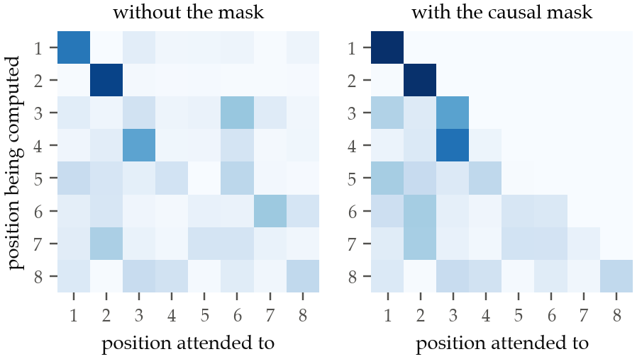

# 25 — Attention

The dense layer mixes features within each input column using a learned
weight matrix. A convolution applies learned kernels over a local
neighborhood. Both use the same learned coefficients for each example,
although nonlinear networks built from them can have input-dependent
responses.

Attention makes the mixing coefficients themselves depend on the input.
Each query receives scores against the keys, and a softmax turns those
scores into weights for combining the values. This gives us an explicit
way to relate positions in a sequence, which we will use for musical
events and audio atoms.

This chapter builds the attention operator in steps:
scaled-dot-product attention as a pure function of `(Q, K, V)`, then
multi-head attention as a `Layer<T>` that learns the projections.
Chapter 26 adds the surrounding components (positional encoding,
LayerNorm, a transformer encoder block).


## 1. Queries, keys, values

The unit of attention is a retrieval. It is like a dictionary lookup
with an approximate comparison. There is a *query* vector and a set of
key/value pairs. The query is compared against every key; the closer
the match, the more that key's *value* contributes to the result. With
exact equality this is a dictionary; with a soft, differentiable
comparison it is a generalisation of one.

For one query `q ∈ R^{d_k}` and a set of `n_k` keys
`{k_j}` and values `{v_j}`:

```
score_j  =  <q, k_j>                          (a scalar similarity per key)
weight_j =  softmax(score_j over all keys)    (a probability per key)
out      =  sum_j  weight_j * v_j              (weighted combination)
```

The operations are a similarity (a dot product) and a weighted sum.
The softmax in between makes it differentiable and guarantees that
the weights sum to 1. The result is a *convex combination* of the
values, so the output stays in the value space.

For a batch of queries (in our case, every token in a sequence is
its own query), we stack them as columns of a matrix `Q ∈ R^{d_k ×
n_q}`. Keys and values stack as columns of `K ∈ R^{d_k × n_k}` and
`V ∈ R^{d_v × n_k}`. The whole batched operation reduces to two
matrix multiplications with a per-column softmax between them:

$$
S=K^\mathsf{T}Q,\qquad
A=\operatorname{softmax}_{\mathrm{columns}}(S),\qquad
\mathrm{out}=VA.
$$

Both $S$ and $A$ have shape $n_k\times n_q$: one column per query.
The output has shape $d_v\times n_q$.

This fits our column-as-example convention: each column of the
output is one query's retrieval.


## 2. The scaling

The formula above is unscaled attention. Scaled-dot-product attention
divides the scores by `sqrt(d_k)` before the softmax:

$$
A=\operatorname{softmax}_{\mathrm{columns}}
\left(\frac{K^\mathsf{T}Q}{\sqrt{d_k}}\right).
$$

The reason is statistical. Under the simplifying assumption that
components of `q` and `k` are independent, zero-mean, and unit-variance,
their dot product has variance `d_k`. Larger score differences can
saturate softmax toward a one-hot distribution, where its Jacobian
entries are small. Dividing by `sqrt(d_k)` keeps the variance at one
under those assumptions. Learned queries and keys need not retain that
distribution, but the scaling is a useful default introduced by
[@vaswani2017attention]. There is no universal dimension threshold at
which an unscaled model must fail.


## 3. Backward {#sec-25-attention-backward}

The forward pass has two matmuls with a softmax between them. The
backward is the same in reverse: matmul backward (which we already
have, since for `Z = W X` the gradient is
`dW = dZ X^T, dX = W^T dZ`) and softmax backward (which `Softmax<T>`
implements column-wise, the form we need).

For `S = (K^T Q) / sqrt(d_k)`, `A = softmax(S)`, `out = V A`, given
`dOut := dL/dout`:

```
dV = dOut A^T                                   (d_v × n_k)
dA = V^T dOut                                   (n_k × n_q)
dS = softmax_backward(dA, A)   per column,
     dS[k, i] = A[k, i] * (dA[k, i] - sum_j A[j, i] dA[j, i])
dQ = (K  @ dS  ) / sqrt(d_k)                    (d_k × n_q)
dK = (Q  @ dS^T) / sqrt(d_k)                    (d_k × n_k)
```

We implement this in `ScaledDotProductAttention<T>` as a plain class
with its own `forward(Q, K, V)` and `backward(dOut)` returning a tuple
`(dQ, dK, dV)`. It owns a `Softmax<T>` instance internally, which
caches `A` for its own backward, so the softmax-backward step needs
no new code.

The numerical-gradient check passes at the ~1e-11 level in double
precision for all three gradients, which is the level the library
requires before it accepts a backward as correct.


## 4. Why three inputs, why not a Layer

`ScaledDotProductAttention` is not a `Layer<T>`. The library's layer
abstraction promises a single matrix input and a single matrix
output. Attention has three inputs and one output. One could stack
`Q`, `K`, `V` vertically into one big matrix and have the layer split
it internally, but that obscures the gradient routing and forces a
specific layout on every caller. Instead we leave the bare operator
as a non-Layer helper and wrap it in a Layer one level up.


## 5. Multi-head attention

A single attention operation produces one weighted combination per
query. One set of `(Q, K, V)` gives one view of the
relationships between positions. Multi-head attention runs `H` such
operations in parallel on disjoint slices of the feature axis, then
concatenates and re-mixes the result. Each head can attend to
something different (one might learn syntactic adjacency, another
long-distance reference, another a position-independent pattern), and
the model can use all of them.

The computation, for input `X ∈ R^{d_model × seq_len}` (one token per column):

```
Q = Wq X                       (d_model × seq_len)
K = Wk X
V = Wv X
  split feature axis into H heads (each of size d_head = d_model / H)
  for h in 0..H-1:
    Q_h = rows [h*d_head, (h+1)*d_head) of Q     (d_head × seq_len)
    K_h, V_h similarly
    Y_h = ScaledDotProductAttention(Q_h, K_h, V_h)
  concat the Y_h back along the feature axis  (d_model × seq_len)
Y = Wo (concat)
```

The four projections `Wq, Wk, Wv, Wo` are the only learnable
parameters; everything else is the deterministic split-attend-concat.
We implement them as four full `Dense<T>` layers. Under the
column-as-example convention each token in the sequence is one
"example", so `Dense(d_model, d_model)` works without modification,
and we inherit He initialisation, biases, save/load and the optimizer
hook from `Dense`. Each head gets its own `ScaledDotProductAttention`
instance, which keeps the softmax caches separate so that per-head
backward works independently.

Gradient routing through MHA needs care at one point: in
self-attention, `X` is the common input to `Wq`, `Wk`, and `Wv`, so
the gradients returning from the three projection backwards must be
summed:

```cpp
Matrix<T> dXq = Wq_.backward(dQ);
Matrix<T> dXk = Wk_.backward(dK);
Matrix<T> dXv = Wv_.backward(dV);
return dXq + dXk + dXv;
```

This detail is easy to miss, and it shows why finite-difference
checks matter: a missing summand here would pass every shape test,
run without warnings, and train a broken model with no visible error.


## 6. Implementation errors we made

These are not conceptual points. They are errors that the test suite
catches and that would otherwise take a long time to debug.

**SIGFPE in the constructor.** Our first multi-head constructor computed
`d_head_` by dividing `d_model` by `n_heads` in its initializer list.
The body checked for `n_heads == 0`, but member initializers run before
the body. Integer division by zero is undefined behavior; on the Linux
test build it trapped with `SIGFPE` before our exception could be
thrown. The fix is to validate in a static helper called from the
initializer list, so that the check happens first.

**One softmax cache per head, not one shared.** Each head needs to
remember its own attention weights for its backward pass, because
the softmax backward formulas depend on the forward output. If
multiple heads shared a single `Softmax<T>` instance, the second
head's forward would overwrite the first's cache, and the first
head's backward would use the wrong weights with no error reported.
We give each head its own `ScaledDotProductAttention` (which in turn
owns its own `Softmax<T>`), so the heads are independent because
each owns its own objects.


## 7. The causal mask

Attention as written above is *bidirectional*: every query attends to
every key in the sequence, with no constraints. That is right for an
encoder, which reads a whole sequence at once. It is wrong for a model
that generates a sequence one token at a time. Such a model is
trained to predict token `i + 1` from tokens `0..i`, and if position
`i` can attend to position `i + 1` it copies the answer. The
training loss goes to zero and the model has learned nothing.

The fix is to forbid attention to later positions. In the score
matrix `S`, row `j` is a key and column `i` is a query, so "query `i`
may not see key `j`" for `j > i` means overwriting the part of `S`
below the diagonal before the softmax:

```
S[j, i] = -inf      for every j > i
```

`exp(-inf)` is exactly zero, so after the softmax those weights are
exactly zero and the remaining ones in the column still sum to 1. Key
0 is never masked, so every column keeps at least one finite score
and the softmax is always well defined. For four tokens the attention
map (keys down, queries across) has this shape:

```
        q0   q1   q2   q3
  k0     1    *    *    *
  k1     0    *    *    *
  k2     0    0    *    *
  k3     0    0    0    *
```

In code it is a flag on the operator and five lines in the forward:

```cpp
Matrix<T> forward(const Matrix<T>& Q, const Matrix<T>& K,
                  const Matrix<T>& V, bool causal = false);

if (causal) {
    const T neg_inf = -std::numeric_limits<T>::infinity();
    for (std::size_t i = 0; i < S.cols(); ++i)
        for (std::size_t j = i + 1; j < S.rows(); ++j)
            S(j, i) = neg_inf;
}
```

The backward needs no change. The softmax backward is
`dS[j, i] = A[j, i] * (dA[j, i] - ...)`. A masked entry has
`A[j, i] = 0`, so its `dS[j, i]` is zero, and nothing reaches `Q` or
`K` through a masked pair. The mask removes those paths from the
forward computation and the existing formulas remove them from the
gradient.

`MultiHeadAttention` exposes the flag as `set_causal(bool)` and passes
it to every head. It is a switch, not a parameter: it is not saved
with the weights, and the same layer can be run both ways.

The tests check the following. The attention map has exact zeros below
the diagonal and its columns still sum to 1. Changing token `t` leaves
every output before `t` bit-identical, while without the mask the
same change does reach them. The gradients still agree with finite
differences, to a few `1e-11` for both the operator and
`MultiHeadAttention`.




## 8. What is not implemented {#sec-25-attention-what-is-not-implemented}

Other common variants are not implemented:

- **Padding masking.** Variable-length sequences in a batch are
  padded to a common length; the padded positions should not
  contribute to any position's attention. The method is the same:
  `-inf` in the score matrix at padded positions. We process one
  sequence per forward pass, so there is nothing to pad.
- **Encoder–decoder cross-attention.** The query comes from the
  decoder's previous layer; the keys and values come from the
  encoder's output. It is the same operator with a different source
  for `(Q, K, V)`. The operator already separates `Q` from `K, V`, so
  this is a usage pattern, not new code.

Chapter 26 builds the surrounding components (sinusoidal positional
encoding, LayerNorm, residual connections) and assembles a complete
transformer block.


## Further reading {#sec-25-attention-further-reading}

Attention as a learned, soft alignment between sequence positions was
introduced for translation by [@bahdanau2015attention]. Scaled
dot-product attention, multi-head attention and the causal mask in the
form built here are from [@vaswani2017attention].
