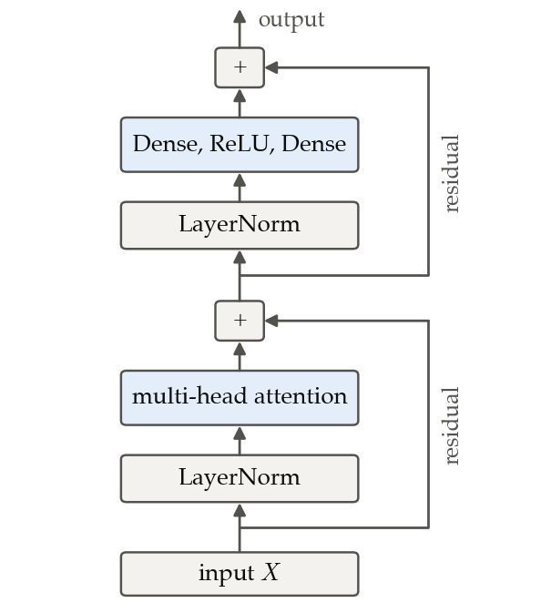

# 26 — Positional encoding, LayerNorm, and the transformer block

[Chapter 25](25_attention.md) built attention as a pure operator on
`(Q, K, V)` and wrapped it in `MultiHeadAttention` with learnable
projections. Attention alone is not yet enough: it has
no notion of where a token sits in the sequence, no normalisation
to keep activations in a workable range across many layers, and no
internal feed-forward to give each position its own learned
transformation between attention passes.

This chapter adds the remaining components and assembles them into a
**transformer encoder block**, the basic repeating unit of a
transformer. None of the ideas is difficult, but a transformer
trained without any one of them either does not learn or does not
generalise. We build each one and end with a single composable
`Layer<T>` that wraps them all.


## 1. Why position matters

Attention is *permutation-equivariant* on the token axis. If you
shuffle the columns of the input, attention shuffles the columns of
the output the same way, and each individual output column is
unchanged. The output at position 3 carries no information about
being at position 3 rather than position 7; it depends only on its
query and on the keys and values the query matched.

For images that is acceptable (a CNN treats translated patches the
same), but for sequences it is a problem. "The cat sat on the mat" and
"Mat the on sat cat the" should not produce the same set of token
representations. We need to add the position to each token's
representation before attention sees it.


## 2. Sinusoidal positional encoding

The "Attention is All You Need" paper [@vaswani2017attention] chose a
simple solution: add a deterministic, fixed pattern to each input token's
embedding, where the pattern depends only on the position.

For position `pos` and feature dimension `i`:

```
PE(pos, 2i)     = sin( pos / 10000^(2i / d_model) )
PE(pos, 2i+1)   = cos( pos / 10000^(2i / d_model) )
```

**Each position is unique.** The frequency progression
`10000^(2i/d_model)` is geometric: at low `i` (early
features) the wavelength is short and the sine oscillates rapidly
with `pos`; at high `i` the wavelength is very long and the sine is
nearly constant across the whole sequence. The combination of all
these frequencies is different for every position.

**Relative offsets are linear.** Because `sin(a + b) = sin a cos b +
cos a sin b`, the encoding `PE(pos + k)` is a (position-independent)
linear function of `PE(pos)`. In principle the network can learn to
attend by offset ("look 3 positions back") from the encoding alone,
without learning an explicit indexing scheme.

`SinusoidalPositionalEncoding<T>` precomputes the full
`(d_model × max_seq_len)` `PE` matrix at construction and adds
it column-wise in forward. Backward is the identity: `d(X + PE)/dX
= I`, so `dX = dY`. It has no parameters and no training cost.

A learned alternative (a `(d_model × max_seq_len)` matrix of free
parameters, no sinusoids) is also common in modern transformers.
We don't build that variant. The sinusoidal version needs no
parameters and is defined for any position. Whether a trained model
can use positions it never saw in training is a separate question,
examined in [chapter 27](27_transformer_chorales.md).


## 3. LayerNorm

Stacking many attention blocks tends to make the activation
magnitudes drift: each block adds and rescales, and small errors
accumulate. The original transformer paper used **LayerNorm** to
control this; modern transformers are essentially never trained
without it.

The formula is, per token (per column `j` of `X`):

```
mu_j      = (1/D) sum_i  X[i, j]
var_j     = (1/D) sum_i  (X[i, j] - mu_j)^2
x_hat[i,j]= (X[i, j] - mu_j) / sqrt(var_j + eps)
Y[i, j]   = gamma[i] * x_hat[i, j] + beta[i]
```

`D` is the feature dimension; `gamma` and `beta` are learnable
`D`-vectors initialised to 1 and 0 respectively (so the layer starts
as an exact standardisation and can learn any other scale and
shift). The `+ eps` (we use `1e-5`) keeps the division safe when the
variance is near zero.

LayerNorm differs from BatchNorm in the axis the statistics come
from: BatchNorm uses the batch (column) axis, LayerNorm uses the
feature (row) axis. Transformers prefer LayerNorm because (i) it
works with any batch size including 1, (ii) it behaves identically at
train and inference time without needing running averages, and
(iii) the per-token statistics make sense for sequences of arbitrary
length where the "batch" might be a single sentence.

**The backward** is the difficult part of LayerNorm. `X[k, j]`
influences `x_hat[i, j]` through three paths:
directly (numerator), via the column mean `mu_j`, and via the column
variance `var_j`. Applying the chain rule, with
`dx_hat[i, j] = dY[i, j] * gamma[i]`,
`S1_j = sum_i dx_hat[i, j]`, and
`S2_j = sum_i dx_hat[i, j] * x_hat[i, j]`, the input gradient is:

```
dX[i, j] = (1 / (D * sqrt(var_j + eps))) *
           ( D * dx_hat[i, j]  -  S1_j  -  x_hat[i, j] * S2_j )
```

`dgamma[i]` and `dbeta[i]` accumulate as `sum_j dY[i, j] * x_hat[i,
j]` and `sum_j dY[i, j]` respectively (the parameters are shared
across the batch, so their gradients sum across it). The
finite-difference test verifies all three to about `1e-10` in double
precision, which is enough to trust the implementation.

The usual scalar loss for a gradient check, the sum of all outputs,
is useless in that test: with
`gamma = 1` every normalised column sums to zero, so the loss does not
depend on `X` at all and any `dX` would pass. The test weights each
output entry by a random number instead, so that every entry of the
gradient matters.


## 4. The transformer encoder block

With attention, positional encoding, and LayerNorm in place we can
assemble the standard encoder block. Several orderings of its
components are in use, and the differences matter in practice; we
use the **pre-LN** variant, which is now the default in modern
transformer implementations because it trains more stably:

```
X --+--> LayerNorm --> MultiHeadAttention --+--> Y
    |                                       |
    +-----------------------(residual)------+

Y --+--> LayerNorm --> Dense -> ReLU -> Dense --+--> Z
    |                                            |
    +-----------------------(residual)-----------+
```

The block has two normalised sub-stacks (attention, feed-forward),
each wrapped in a residual connection. The feed-forward sub-stack is
a standard two-Dense bottleneck, `d_model → d_ff → d_model`, with
`d_ff` usually `4 * d_model`. The 4× expansion gives the per-position
transformation enough capacity; the ReLU is the only nonlinearity in
the sub-stack.

The **residual connections** are essential. Without them, training a
stack of more than a few of these blocks fails, because gradients
vanish through the long chain of matmuls and softmaxes. With them,
the gradient has an identity path around each sub-stack, and networks
hundreds of layers deep can be trained. It is the same technique as
in ResNet [@he2016resnet], with the same role.

In code, each block is one `Layer<T>` that owns six sub-layers in
fixed order:

```cpp
LayerNorm<T>            ln1_;
MultiHeadAttention<T>   mha_;
LayerNorm<T>            ln2_;
Dense<T>                ff1_;
ReLU<T>                 relu_;
Dense<T>                ff2_;
```

Forward chains them with the two residual sums. Backward chains them
in reverse, with the residuals contributing identity gradients that
sum with the sub-stack gradients at the residual junctions:

```cpp
Matrix<T> backward(const Matrix<T>& dZ) {
    // FFN sub-stack:  Z = Y + FFN(LN2(Y))
    Matrix<T> df  = dZ;
    Matrix<T> de  = ff2_.backward(df);
    Matrix<T> dd  = relu_.backward(de);
    Matrix<T> dc  = ff1_.backward(dd);
    Matrix<T> dY_from_ffn = ln2_.backward(dc);
    Matrix<T> dY  = dZ + dY_from_ffn;

    // Attention sub-stack:  Y = X + Attn(LN1(X))
    Matrix<T> db  = dY;
    Matrix<T> da  = mha_.backward(db);
    Matrix<T> dX_from_attn = ln1_.backward(da);
    return dY + dX_from_attn;
}
```

The finite-difference check on `dX` agrees with the analytical
gradient to a few `1e-9` in double precision. This is looser than the
individual sub-layer checks (which were between `1e-11` and `1e-10`)
because the block is a long chain. With the step `1e-5` used for
single layers the disagreement is `1e-8` to `1e-7`, and it shrinks a
hundredfold when the step shrinks tenfold. That scaling is
characteristic of the finite difference's own truncation error, not
of a wrong gradient, so the block's test uses a step of `1e-6`.

**A causal block.** `set_causal(true)` on the block switches its
attention sub-layer to the causal mask of chapter 25. Nothing else has to
change, because LayerNorm, the feed-forward sub-stack and the
residuals all act on one token at a time and cannot carry information
from a later position to an earlier one. A stack of causal blocks is
therefore a *decoder-only* transformer, the architecture of every
autoregressive language model, and it is the form we use from here on.
The test changes one token and checks that every earlier output is
bit-identical. (The change has to differ from feature to feature:
LayerNorm removes a constant added to a whole column, so a uniform
shift would have no effect on the block's output and the test would
prove nothing. We made that mistake in the first version of the
test.)




## 5. Parameter count

The parameters of one encoder block at `d_model = 512`,
`n_heads = 8`, `d_ff = 2048`:

- Two LayerNorms: `2 * (512 + 512)` = 2,048 parameters
- One MultiHeadAttention: four `(512, 512)` projections with bias =
  `4 * (512 * 512 + 512)` = 1,050,624 parameters
- One feed-forward: `(2048, 512) + (512, 2048)` projections with bias
  = `2048*512 + 2048 + 512*2048 + 512` = 2,099,712 parameters
- **Total per block: ~3.15 million parameters**

For comparison, our ConvVAE for audio (chapter 23) had about 0.6 million
in total across the whole encoder + decoder. A single encoder block
at typical transformer sizes already has more parameters than the
entire ConvVAE. The large size of modern deep learning models comes
from architectures that repeat small blocks dozens of times, not from
more complicated operations. Twelve of these blocks stacked is a
small transformer (~38M parameters). GPT-2 large stacks thirty-six
wider ones (`d_model = 1280`) for about 774M.


## 6. What remains

We now have every part of a transformer: attention with an optional
causal mask, positional encoding, LayerNorm, and a block that composes
them. We have not yet trained one.

The full encoder–decoder transformer of the original paper adds
cross-attention, where the decoder queries the encoder output. We
don't build it: it is the same operator with `Q` taken from one
source and `K, V` from another, and the generative models in the next
chapters are decoder-only, which need only the causal block above.

Chapter 27 uses these parts. It adds a token embedding, stacks
causal blocks into an autoregressive model, and trains it on four-voice
chorales, so that sampling from it one token at a time produces new
ones.


## Further reading

The transformer and its sinusoidal positional encoding are
[@vaswani2017attention]. Layer normalisation is [@ba2016layernorm], and
the case for placing it before each sub-layer, as we do, is made in
[@xiong2020prelayernorm]. Residual connections come from
[@he2016resnet]. The sizes quoted for GPT-2 are from
[@radford2019gpt2].
