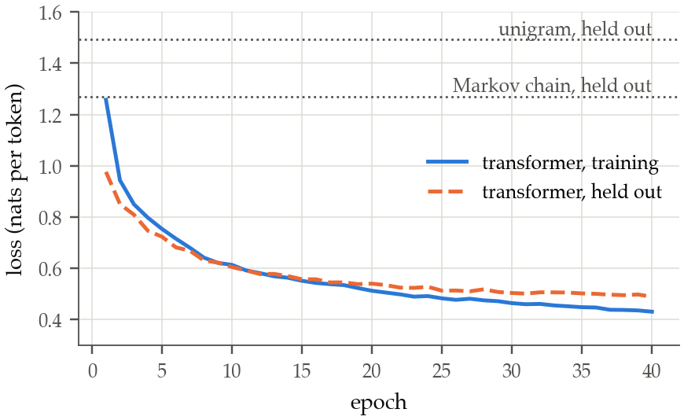
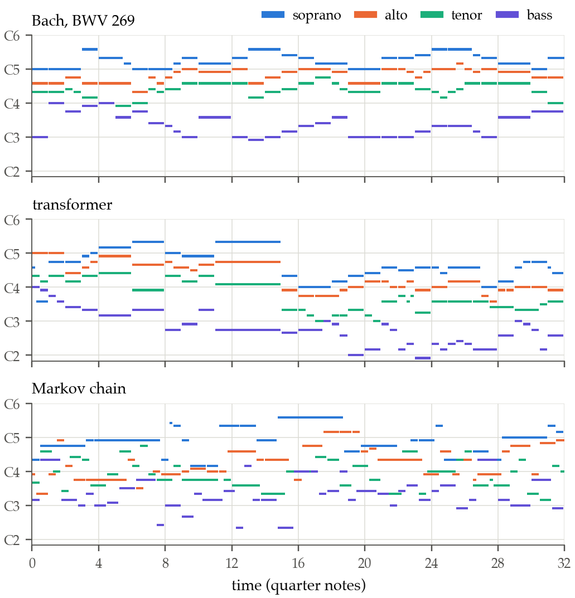

# 27 — A transformer that writes chorales

The examples in this book so far have done things that classical
signal processing already does. Phase vocoders cross-synthesised
timbres in the 1980s. Markov chains have generated plausible-sounding
folk melodies since the 1950s. If a book on neural networks stops at
examples that match those older methods, the reader may reasonably
ask what the gradient computations were for.

This chapter answers that question for the attention chapters. The
task is the generation of four-voice chorales in the style of Bach,
and Markov chains cannot do it. A first-order Markov chain over one
voice produces a plausible melody. Extending it to four voices means
joint transitions over the cartesian product of the voice states.
The number of states grows exponentially, and on any realistic corpus
most transitions are never observed. Higher-order Markov chains make
the same problem worse. The constraint we want to model is correct
voice leading across four simultaneous voices over many bars. It is a
long-range, joint, structured dependency, which is the kind of
dependency transformer attention is designed to model.

This was the motivation for DeepBach [@hadjeres2017deepbach] and
Coconet [@huang2017coconet]: chorales are a test case where neural
sequence models clearly do better than the classical methods before
them. We build a much smaller version of the same idea. Ours is
autoregressive, which is simpler than either (DeepBach rewrites
iteratively and Coconet is masked and orderless), but it demonstrates
the same thing.


## 1. What this chapter adds

Chapters 25 and 26 built `MultiHeadAttention`, `SinusoidalPositionalEncoding`,
`LayerNorm` and `TransformerEncoderBlock`. With the causal mask of
chapter 25 switched on (`set_causal(true)` on every block), a stack of
those blocks can already generate: each position sees only the
positions before it, so the model can be trained to predict the next
token and then run one token at a time. Token input and MIDI input
and output are still missing, and neither is about attention.

**Tokens in.** A language model takes integer token IDs, not vectors.
`Embedding<T>`, the lookup table used in chapter 24 for twelve
instruments, does the conversion. Here its vocabulary is the 134
tokens defined below. It holds a `(d_model × vocab_size)` parameter
matrix `W`. The forward pass returns, column by column, the vectors
of the input tokens. The backward pass adds the upstream gradient
into the columns that were looked up, so that a token occurring
several times in a sequence receives the sum of its gradients. The
test checks this with a token that occurs twice, and also that a
token which does not occur receives exactly zero. It is not a
`Layer<T>` subclass because its input is `std::vector<int>` rather
than `Matrix<T>`. We give it a compatible forward/backward/update
interface and call it from `TokenTransformer<T>`
(`src/TokenTransformer.h`), the class that fixes the order of the
layers in section 3.

**MIDI in and out.** MIDI is a binary format with big-endian
multi-byte values and delta times stored as variable-length
quantities. `Midi.h` reads Format 0 and Format 1 and writes Format 1,
with note-on and note-off events, tempo, and the "running status"
abbreviation in the parser. Other event types (sysex, control
changes, pitch bend, program changes) are skipped on read and not
written. This restriction of scope is deliberate. The file is about
330 lines.

The round-trip test in `tests/test_midi.cpp` found a bug on its first
run. The bug cannot be heard on a chorale. The reader was taking each
note's velocity from its note-off event. In MIDI both events carry a
velocity, but only the note-on velocity is the loudness of the note.
The note-off velocity is a release speed, and most files write 64
there. Every note therefore came back at velocity 64. A dataset in
which all notes are equally loud hides the bug completely. A test
that writes a note at velocity 90 and reads it back does not.


## 2. Tokenisation

Tokenisation is the choice with the largest consequences and the
least theoretical interest. Every successful music transformer paper
has invented its own.

For four-voice chorales we use the scheme that DeepBach shows to be
adequate:

1. **Quantise** every voice to 16th-note onsets. This loses
   ornamentation but keeps the structural content of a chorale.
2. **Flatten** the four voices into one stream, emitting four tokens
   per 16th-note time step in the fixed order S, A, T, B.
3. **At each step in each voice**, emit one of three things: the
   MIDI pitch number (0-127) if a new note begins here; `HOLD` if
   the note that began earlier is still sounding; `REST` if the voice
   is silent. A note repeated at the same pitch is a new note, and
   gets its pitch token again.

A 32-bar chorale at 4/4 with this scheme is `4 × 16 × 32 + 2 ≈ 2050`
tokens (the +2 are `BOS` and `EOS` sentinels). The vocabulary is
small: 128 pitches + REST + HOLD + BOS + EOS + 2 reserved = 134
tokens.

The scheme has practical consequences for what the model learns:

- **Voice order is fixed.** The model always sees `S0 A0 T0 B0 S1 A1
  T1 B1 ...`, so it learns that position-mod-4 identifies the voice.
  This helps: voice ranges are consistent, and voice leading is
  predictable within position-mod-4 groups. It is also a constraint:
  the model cannot be monophonic, drop a voice or add a fifth one.

- **The balance of HOLD and attacks.** Most 16th-note steps do not
  start a new note. They continue a longer one. A model that emits
  too many attacks produces continuous staccato 16th notes. A model
  that emits too many HOLDs produces music made of whole notes. The
  balance has to be learned from the training data, so the training
  data has to sound like chorales (4-voice texture, mostly quarter
  and half notes, occasional 16ths).


## 3. The model

The model is a small decoder-only stack, the standard GPT-style
design. In the library it is the class `TokenTransformer<T>`:

```
tokens (L integers)
   |
   v
Embedding(vocab, d_model)          -> (d_model x L)
   |
   v
SinusoidalPositionalEncoding       -> (d_model x L)
   |
   v
TransformerEncoderBlock x N        -> (d_model x L)      (causal mask on)
   |
   v
LayerNorm                          -> (d_model x L)
   |
   v
Dense(d_model -> vocab)            -> (vocab x L)
   |
   v
Softmax                            -> (vocab x L)
```

Our defaults are `d_model = 128`, `n_heads = 4`, `n_layers = 2`,
`d_ff = 4 * d_model`. That is about 430k parameters, small enough to
train on a CPU and large enough to learn non-trivial voice leading.
The block size for training is 128 tokens (32 time steps = 2 bars at
4/4). At inference we step one token at a time.

One training step:

1. Pick a random chorale token sequence from the corpus.
2. Pick an offset inside it that is a multiple of 4; take a 128-token
   window as `input` and the same window shifted by one as `target`.
   One window in ten starts at the beginning of its chorale.
3. Forward through the model with the causal mask on. The output is
   a probability over 134 tokens at every one of the 128 positions
   in the chunk.
4. Loss = cross-entropy between predicted probabilities and
   one-hot targets, averaged across positions.
5. Backward, Adam step.

Every position in the chunk produces a prediction, not only the last,
so one chunk gives 128 supervised gradients for the cost of one
forward pass. This is the main efficiency advantage of training a
transformer on all positions in parallel. At inference the model has
to run one token at a time, because sampling requires it.

**Why the offset is a multiple of 4.** Token 0 is `BOS` and tokens
1 to 4 are the four voices of the first time step, so a window that
starts at a multiple of 4 always has S, A, T, B at positions 1, 2, 3,
0 (mod 4). The positional encoding then tells the model which voice
it is writing. We did not do this at first. With arbitrary offsets
the model has to work out from the notes themselves which voice comes
next, and section 5 shows the effect. The one-in-ten rule has a
similar reason: a uniformly random offset shows the model the opening
of a chorale about once in two hundred windows, and a generator that
has rarely seen an opening starts badly.


## 4. Sampling

Generation is a loop:

```
context = [BOS]
loop:
    probs = model.forward(context)       # (vocab x len(context))
    next = sample_from(probs[:, -1], temperature)
    context.append(next)
    if next == EOS: break
```

The `temperature` parameter rescales the probability distribution
before sampling. Low temperatures (0.5-0.8) favour the most probable
tokens and give more conservative output. High temperatures (1.0-1.5)
flatten the distribution and give more varied output that is
sometimes incoherent. Temperature 1.0 samples directly from the
model's distribution.

**The context must match training.** The model was trained on
windows of 128 tokens that begin at position 0 of the positional
encoding. At generation time it must be shown the same thing: the
last 128 tokens (rounded so that the window still starts at a
multiple of 4), not the whole sequence so far. Coherence beyond 32
time steps therefore comes only from what the window still contains.

Our first sampler got this wrong, and nothing in training showed it.
It passed the whole sequence, up to the 1024 positions the encoding
table holds. Positions beyond 127 had never occurred in training, so
after the first two bars the model was working from encodings it had
never seen. The loss curve looked good throughout, because the loss
is measured on training-sized windows.


## 5. Results

The corpus is the set of four-part Bach chorales distributed with
music21 [@cuthbert2010music21]. `data/make_chorales.py` writes 365 of
them as four-track MIDI files, each transposed to C major or A minor
so that a small model does not have to learn every key separately.
One chorale in ten is held out.

**Prediction.** The program fits two baselines on the training
chorales and scores them, like the transformer, by the average
cross-entropy of the held-out chorales, in nats per token:

| Model | Held-out loss |
|---|---|
| Uniform over the 134 tokens | 4.90 |
| Unigram | 1.49 |
| First-order Markov chain per voice | 1.27 |
| Transformer, 1 epoch (17 s) | 0.98 |
| Transformer, 10 epochs | 0.60 |
| Transformer, 40 epochs (8 min) | 0.49 |

A loss of 0.49 is a perplexity of 1.6: at each step the model is, on
average, undecided between fewer than two tokens. The transformer
does better than the Markov chain within its first epoch.

**Generation.** A low loss says the model predicts Bach well. It does
not say that what it writes is good, and the two can differ widely,
so we measure the generated music directly.
`transformer_chorales stats` computes, for a set of MIDI files, how
often the upper voices form a consonance with the bass (a unison,
third, fifth, sixth or octave), how often two neighbouring voices are
in the wrong order, how many of the moves in which two voices both
change pitch are parallel fifths or octaves, and the average length
of a note. We compare ten chorales of 256 time steps from each
generator with the 365 originals:

| | Consonant with bass | Voices crossed | Parallel 5ths/8ves | Quarter notes per attack |
|---|---|---|---|---|
| Bach | 85% | 2% | 0.2% | 0.95 |
| Markov chain per voice | 57% | 44% | 2.8% | 0.92 |
| Transformer | 82% | 3% | 5.8% | 0.94 |

The Markov chain produces four plausible lines that are independent
of one another: its voices cross almost half the time and its harmony
is not far from what chance would give. The transformer keeps the
voices in order about as reliably as Bach does, is consonant nearly
as often, and has the same rhythmic density. This is the difference
that attention was expected to make, and it is measured here.

The output still differs from Bach. Parallel fifths and octaves,
which the chorale style avoids almost completely, are thirty times as
frequent as in the originals and twice as frequent as in the Markov
output. The model has learned that voices move together, but not the
rule that restricts how they may move.

**Bugs that the loss did not show.** The table above is the
fourth version. With the sampler that passed the whole sequence
(section 4), the generated chorales had voices crossing 82% of the
time, worse than the Markov chain. Fixing the sampler improved the
harmony and left the crossing at 80%. Aligning the training windows
to time steps (section 3) brought it to 13%. The last step, to 3%,
came from the tokeniser: it had been writing `HOLD` whenever a voice
had the same pitch as on the previous step, so a note repeated at the
same pitch was merged into one long note and the model never saw
where a repeated note begins. In every one of these versions the
training loss looked fine. The held-out loss with the first bug was
0.52, against 0.49 now. Judged by its loss alone, the first version
would have been reported as a success, although its generator was
worse than the baseline.

**What the model does not cover.** Rhythm beyond 16th-note
quantisation, dynamics, articulation, lyric setting and large-scale
form are outside it. All of these need either richer tokenisation,
explicit conditioning (a key, a chorale text, a chord sequence to
harmonise), or training data with the relevant variation.

```
python3 data/make_chorales.py
transformer_chorales train    data/chorales  chorale_model  40
transformer_chorales generate chorale_model  out.mid  256  1.0  1
transformer_chorales markov   data/chorales  markov.mid  256  1
```






## 6. Discussion

The dense classifier, the convnet, the audio VAEs and the
differentiable synthesiser each did something that classical signal
processing or classical statistics already does, sometimes better.
This is the first example in the book where the classical baseline is
measured on the same data and is clearly worse, and where the reason
is the architecture: a per-voice Markov chain cannot represent an
agreement between voices, and a model that attends across the whole
texture can.

The model is small, the corpus is small, and the output is a student
exercise in the style. Nobody would mistake it for a real chorale.
The claim is narrower: with only the layers built in this book,
running on a laptop CPU for eight minutes, a network learns a joint,
structured property of four-voice music from examples alone.

The last two chapters apply the same model to sound instead of
symbols. [Chapter 28](28_matching_pursuit.md) builds a way to write
recorded audio as a list of discrete events, the atoms of a
matching-pursuit decomposition [@mallat1993mp].
[Chapter 29](29_atom_transformer.md) trains this transformer on those
atoms, so that what it writes can be heard directly.


## Further reading

Generating Bach chorales with neural networks has a long history.
[@boulanger2012modeling] established the chorales as a benchmark for
polyphonic sequence models, and DeepBach [@hadjeres2017deepbach] and
Coconet [@huang2017coconet] are the best-known systems built for
them. The decoder-only transformer trained to predict the next token
is the design of [@radford2018gpt], and its application to music with
long-range structure is [@huang2019musictransformer]. The corpus
comes from music21 [@cuthbert2010music21].
