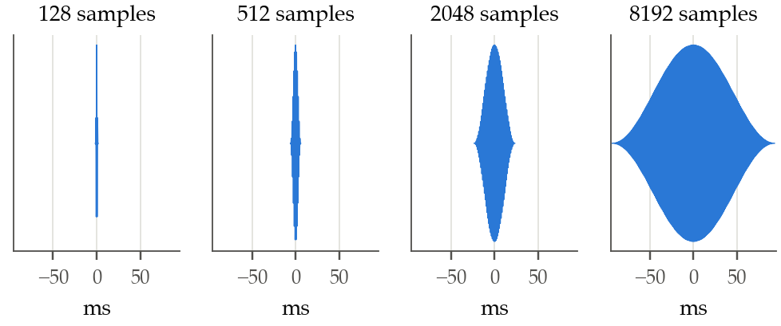
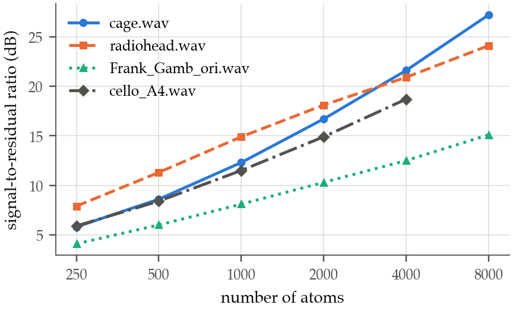

# 28 — Matching pursuit: a sound as a list of atoms

The chorale transformer of [chapter 27](27_transformer_chorales.md)
generates music, but it generates symbols, and the symbols still have
to be performed. In the last two chapters of this book we want a
model that writes something we can listen to directly.

The obvious approach would be to make the transformer predict audio
samples, or spectrogram frames. Chapters 19 and 23 show the result at
our scale: a small network asked to produce a spectrum produces a
blurred one. We follow
[chapter 24](24_differentiable_synthesis.md) instead, where the audio
became clean when the network stopped producing sound and produced
instructions for something that makes sound.

For the chorales the instructions were notes. For recorded sound we
need an equivalent: a way to write any sound as a list of discrete
events, and to turn any such list back into sound. This chapter
builds it, without a neural network. The method is called matching
pursuit [@mallat1993mp], and its events are called atoms.


## 1. Why a list and not a grid

A spectrogram describes a sound on a fixed grid. Every frame and
every bin has one number, whether anything is happening there or
not. A ten-second sound at our settings is several hundred thousand
numbers, most of them describing silence between partials.

Matching pursuit describes the same sound as a list: "a 186 ms tone
at 440 Hz starting at 1.20 s with this amplitude; a 3 ms click at
2.05 s; ...". Each entry is an **atom**, a short windowed sinusoid,
and the sound is approximated by their sum. The length of the list
depends on how complicated the sound is, not on how long it lasts.

A list of events is a sequence, which is what a transformer models.
Each event is also a real piece of sound: whatever list a model
writes, rendering it gives clean windowed sinusoids, not a blurred
spectrum. These properties are why the next chapter uses this
representation.


## 2. The dictionary

An atom is a Hann window of length `N` multiplied by a cosine and
scaled to unit energy:

```
g[n] = w_N[n] * cos(2 pi k n / N + phase)     for n = 0 .. N-1
```

The set of all atoms we allow is the **dictionary**. Ours contains
every frequency bin `k` of four window lengths at once, at time
positions a quarter-window apart:

| Window length | Duration at 44.1 kHz | Frequency resolution |
|---|---|---|
| 128 | 2.9 ms | 345 Hz |
| 512 | 11.6 ms | 86 Hz |
| 2048 | 46.4 ms | 22 Hz |
| 8192 | 185.8 ms | 5.4 Hz |

There are several lengths because of a basic trade-off in signal
processing. A short window says precisely when something happened
and almost nothing about its pitch. A long window does the opposite.
A spectrogram has to use one length. A dictionary can describe a
click with a 3 ms atom and a sustained partial with a 186 ms atom in
the same decomposition. The test suite checks this: given a
12-sample click, the first atom chosen is the shortest, and given a
steady sine it is the longest, at the sine's frequency.




## 3. The algorithm

Matching pursuit is a short greedy algorithm:

```
residual = signal
repeat:
    find the atom g that correlates best with the residual
    a = <residual, g>
    residual = residual - a * g
    record (g, a)
```

Because `g` has unit energy, each step removes `a^2` of energy from
the residual, so at every step

```
||signal||^2  =  ||residual||^2  +  sum of a^2 over the atoms so far
```

The residual can only shrink, and the atoms come out roughly in order
of importance: the first few hundred carry most of the energy.
Because of this ordering, cutting the list sets how much detail is
kept.

The algorithm is greedy and does not find the best set of `n` atoms,
only a good one. Each atom is chosen without regard for what later
atoms could have done.


## 4. Making it fast

Finding the best atom involves millions of candidates. The search in
`MatchingPursuit.h` uses two shortcuts.

**The search is a Fourier transform.** The correlation of the
residual with every atom of one window length at one time position
is one frame of a short-time Fourier transform of the residual. A
single FFT gives the correlation for all frequencies, and its phase
gives the best phase for each. The dictionary is therefore never
stored: it is the STFT, at four window lengths.

**Updates are local.** Subtracting an atom changes the residual only
under that atom. After each step we recompute only the frames that
overlap it: about twenty FFTs for the shortest atom, a few hundred,
mostly short ones, for the longest. For every frame we keep only its
best bin. Choosing the next atom is then a scan over frames.

The FFT gives the correlation with a complex exponential. For a real
cosine that is a very good guide to which atom is best and what its
phase should be, but it is not the exact coefficient, because a real
cosine also has a mirror image at negative frequency. Once the atom
is chosen we therefore build it in the time domain and compute
`a = <residual, g>` exactly. This keeps the energy identity exact,
and the test checks it to six digits. For the same reason the lowest
and highest bins, where a cosine and its mirror image coincide, are
left out of the search.

With this, decomposing eleven seconds of audio into 8,000 atoms takes
about eleven seconds on one core.

**Atoms at the ends of the signal.** Atoms may overhang the ends of
the signal, and the part of an atom that falls outside is not in the
residual that `decompose` returns. Our first energy test failed by
0.06% for that reason: the identity holds on the padded signal, not
on the cropped one. The test now gives its signal a silent margin at
each end, which makes the comparison exact.


## 5. How many atoms a sound needs

`mp_analyze decompose` writes the atom list of a recording and reports
how much of the signal's energy the first `n` atoms explain:

```
mp_analyze decompose  data/cage.wav  cage  8000
```

The recordings are `cage.wav`, `radiohead.wav`,
`Frank_Gamb_ori.wav` (abbreviated as Gamb), and a TinySOL cello note.

| Sound (duration) | 500 atoms | 2,000 atoms | 8,000 atoms |
|---|---|---|---|
| Cage, 11.4 s | 86% | 98% | 99.8% |
| Radiohead, 12.8 s | 93% | 98.5% | 99.6% |
| Gamb, 10.0 s | 75% | 91% | 97% |
| Cello A4, 7.5 s | 86% | 97% | 98.7% |

The last result for the cello uses 4,000 atoms; the other rows use
8,000 in that column.

Eight thousand atoms are five numbers each, 40,000 numbers for half a
million samples: under a tenth of the waveform. Two thousand atoms,
about 175 per second, lose the finest detail and keep the sound
recognisable. That is the size we use in the next chapter.

The third sound is the hardest of the four: even 8,000 atoms leave
3% of its energy unexplained. A sound whose energy is spread over
many short-lived components needs many atoms, and a greedy algorithm
with a fixed dictionary has no cheaper way to represent them.

The decomposition also describes each sound. In the cello note, 95%
of the atoms' energy is in the longest window and five of its 4,000
atoms use the shortest. It is a sustained tone and the dictionary
represents it as one. In `cage.wav` 61% is in the longest window and
the rest is spread across the shorter ones.




## 6. Editing a sound by editing its list

Once a sound is a list, operations that are awkward on a waveform
become small changes to the list. `mp_analyze render` provides the
following.

- **Truncation.** Keeping only the first `n` atoms simplifies the
  sound crudely but effectively, since the list is ordered by
  importance.
- **Separation.** Rendering only the long atoms gives the steady,
  pitched part of the sound; rendering only the short ones gives the
  attacks and the noise. Nothing was trained to do this: the split
  follows from which window length the algorithm found best.
- **Time stretching.** Move the centres of the atoms apart and leave
  each atom's length, frequency and amplitude as they are. Only its
  phase is advanced, so that a partial running from one atom into the
  next stays aligned. Duration changes. Pitch and timbre do not,
  because no atom was resampled. A phase vocoder
  [@flanagan1966phase] does the same by different means.
- **Transposition.** Change each atom's frequency and leave its time
  alone. Our version rounds every atom to the nearest bin of its
  window length, which is audibly coarse for short atoms.

These are classical transformations and classical methods do them
better. They are here to show that the representation is workable.
The next chapter replaces the hand-written editing rule with a
learned one: a model that writes the list itself.

```
mp_analyze render  cage.atoms  out.wav  long
mp_analyze render  cage.atoms  out.wav  stretch 2
```


## 7. Properties and limitations

Matching pursuit is a codec: a way to go from a waveform to a compact
description and back. It has no parameters to train and nothing in
it is learned.

Its limits are those of its dictionary. Every atom has a constant
frequency, so a glissando or a wide vibrato is approximated by many
short pieces. Every atom is a sinusoid, so noise is expensive: the
residual of each decomposition above is mostly noise that would take
thousands more atoms to capture. The algorithm is greedy, so two
partials that are close in frequency can be explained by one atom
between them and a correction, where two well-placed atoms would have
done better.

It gives recorded sound what the chorales already had: a discrete,
ordered, meaningful description, with a way back to audio that cannot
blur.


## Further reading {#sec-28-matching-pursuit-further-reading}

Matching pursuit with time-frequency dictionaries, including the
Gabor dictionary used here and the energy argument of section 3, is
[@mallat1993mp]. Sinusoidal modelling [@mcaulay1986sinusoidal] and
spectral modelling synthesis [@serra1990sms] are the related
tradition that tracks partials over time instead of selecting
independent atoms. The time-stretching of section 6 is the oldest
application of the phase vocoder [@flanagan1966phase].

Matching pursuit is also used in computer-assisted orchestration. The
target is a sound to be imitated by an orchestra, and the dictionary
is a collection of recorded instrument notes in place of windowed
sinusoids. Orchidea [@cella2022orchidea; @cella2021orchideapractice]
combines a stochastic matching pursuit with other optimisation
methods to find the notes.
